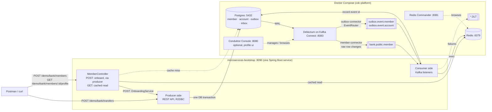
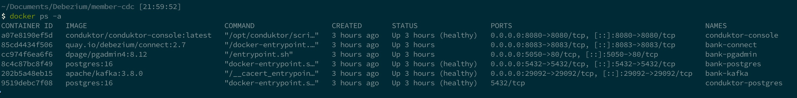
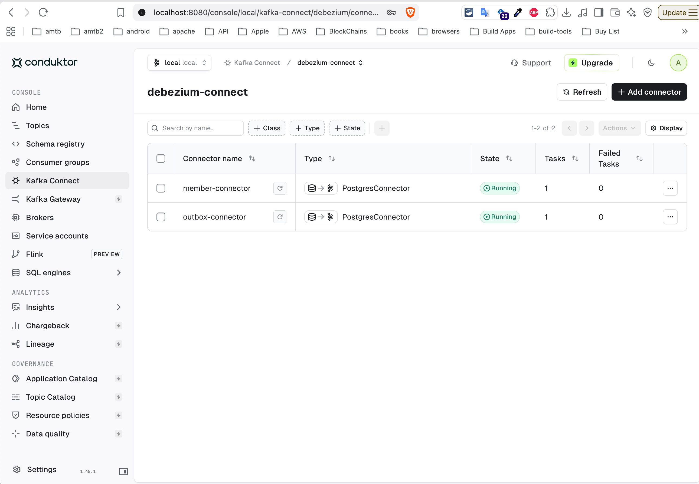
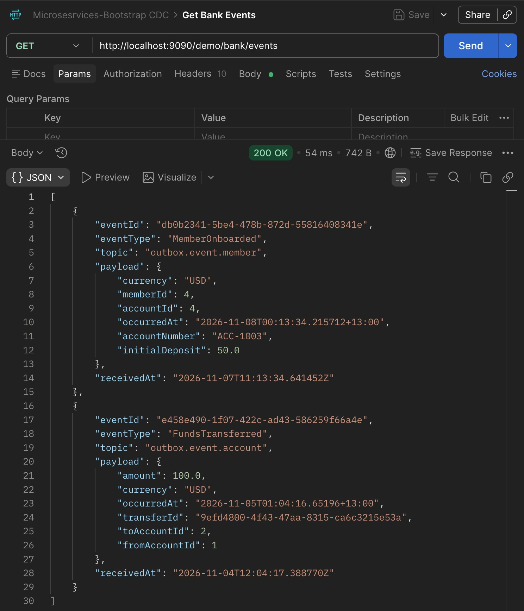
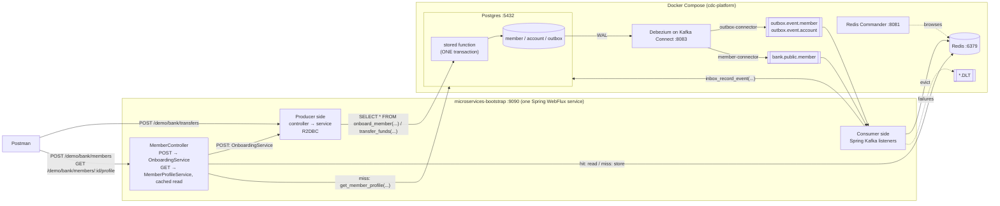
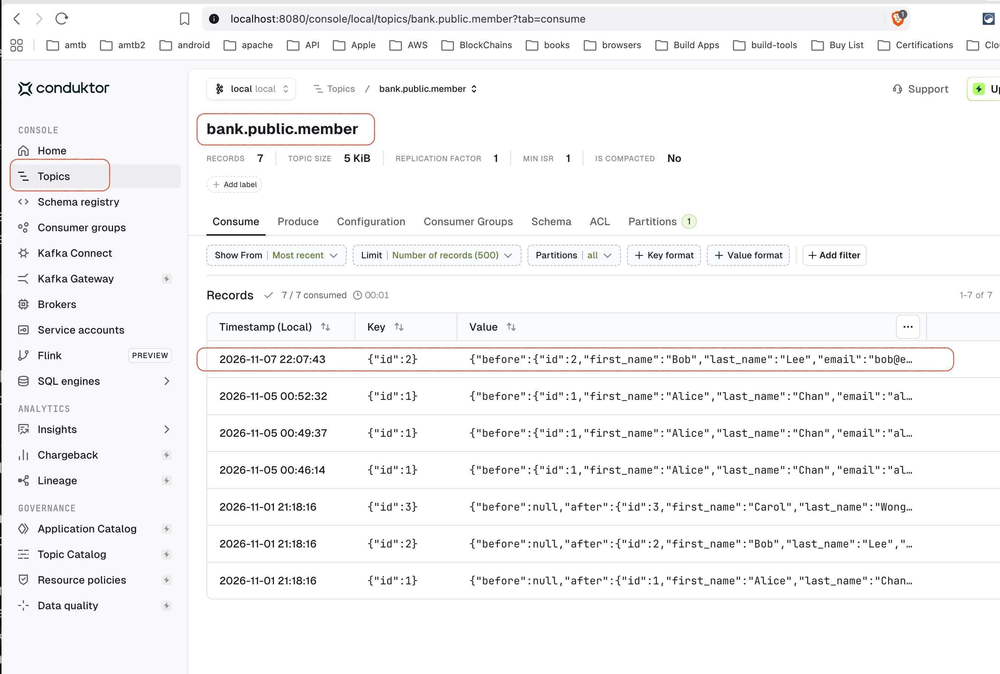
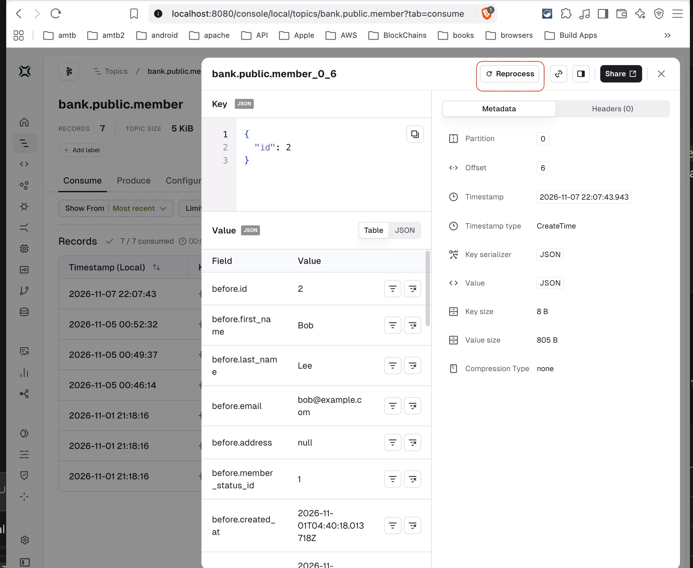
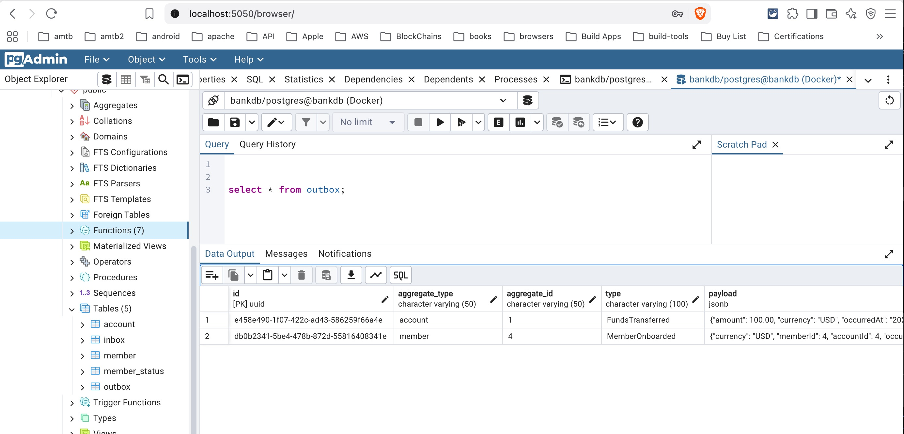
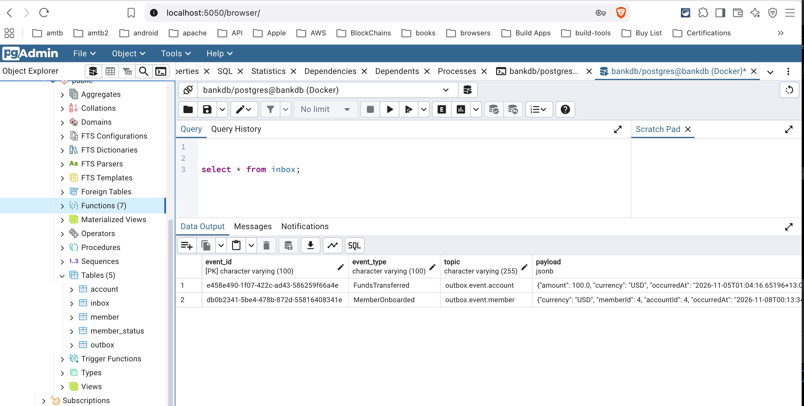

# CDC & Transactional Outbox with Debezium

**Postgres → Debezium (within Kafka Connect) → Kafka → Spring Boot**

A hands-on reference project showing how to get changes out of a relational database reliably and react to them in a Spring Boot service. This repository holds the **platform** (Postgres, Kafka, Kafka Connect with Debezium, the SQL and the connector definitions) and the explanation of how the pieces fit together. The Spring Boot code, a producer that writes business events and a consumer that reacts to them, lives in a companion project, [microservices-bootstrap](https://github.com/sam888/microservices-bootstrap/tree/cdc-outbox-debezium-kafka), where both run in **one service** that you drive from Postman or `curl`. Everything runs on your laptop with Docker Compose.

> **Disclaimer:** This project is a work in progress. It reflects my current PoC integration of CDC, Debezium, Kafka and the outbox pattern, and I am **not** claiming that it follows best practice or is production-ready. Some choices favour a clear demo over production hardening (demo credentials, a single Kafka broker, no authentication on Kafka or Connect). Please check anything you rely on against the official documentation, and if you spot a mistake or a better approach, an issue or pull request is very welcome.

## Contents

- [CDC \& Transactional Outbox with Debezium](#cdc--transactional-outbox-with-debezium)
  - [Contents](#contents)
  - [Motivation](#motivation)
    - [The problem this project solves](#the-problem-this-project-solves)
      - [What this costs you](#what-this-costs-you)
    - [Why you would want this](#why-you-would-want-this)
    - [The usual ways to wire this up, and why they hurt](#the-usual-ways-to-wire-this-up-and-why-they-hurt)
    - [What CDC with Debezium changes](#what-cdc-with-debezium-changes)
      - [Case 1, raw table CDC](#case-1-raw-table-cdc)
      - [Case 2, the transactional outbox](#case-2-the-transactional-outbox)
  - [Objectives and architecture](#objectives-and-architecture)
  - [Quick start](#quick-start)
    - [1. Start the platform](#1-start-the-platform)
    - [2. Register the Debezium connectors](#2-register-the-debezium-connectors)
    - [3. Check Redis](#3-check-redis)
    - [4. Start the Spring Boot app](#4-start-the-spring-boot-app)
    - [5. Smoke-test both parts](#5-smoke-test-both-parts)
    - [6. Explore](#6-explore)
    - [7. Stop](#7-stop)
  - [Key concepts (glossary)](#key-concepts-glossary)
    - [Database side](#database-side)
    - [Kafka side](#kafka-side)
    - [Debezium and Kafka Connect](#debezium-and-kafka-connect)
    - [Delivery and reliability](#delivery-and-reliability)
    - [The outbox pattern](#the-outbox-pattern)
  - [What is a dual write?](#what-is-a-dual-write)
  - [How changes flow: streaming, queueing and catching up](#how-changes-flow-streaming-queueing-and-catching-up)
    - [Where changes wait when something is slow](#where-changes-wait-when-something-is-slow)
    - [Snapshot, then streaming](#snapshot-then-streaming)
    - [Measuring lag](#measuring-lag)
  - [Why Kafka + Kafka Connect rather than Debezium Server + RabbitMQ](#why-kafka--kafka-connect-rather-than-debezium-server--rabbitmq)
    - [Why I chose Kafka for this project](#why-i-chose-kafka-for-this-project)
    - [When RabbitMQ + Debezium Server is the better choice](#when-rabbitmq--debezium-server-is-the-better-choice)
    - [Trade-offs at a glance](#trade-offs-at-a-glance)
  - [Repository layout](#repository-layout)
    - [What creates and seeds each table](#what-creates-and-seeds-each-table)
      - [The scripts run only once](#the-scripts-run-only-once)
  - [What the Java code does](#what-the-java-code-does)
    - [Layering](#layering)
    - [Stored functions: the SQL the Java code calls](#stored-functions-the-sql-the-java-code-calls)
      - [What each function does, step by step](#what-each-function-does-step-by-step)
      - [Why this keeps the outbox guarantee](#why-this-keeps-the-outbox-guarantee)
      - [Errors and SQLSTATE codes](#errors-and-sqlstate-codes)
      - [About the `UB` codes](#about-the-ub-codes)
      - [Functions, not procedures](#functions-not-procedures)
      - [Trade-offs](#trade-offs)
    - [Consumer: how an event travels through the code](#consumer-how-an-event-travels-through-the-code)
    - [Producer: how a request travels through the code](#producer-how-a-request-travels-through-the-code)
  - [The companion app walkthrough (microservices-bootstrap)](#the-companion-app-walkthrough-microservices-bootstrap)
    - [The problem this solves](#the-problem-this-solves)
      - [What this project does about it](#what-this-project-does-about-it)
    - [Architecture](#architecture)
    - [Why producer and consumer are in the same service here](#why-producer-and-consumer-are-in-the-same-service-here)
    - [Where the SQL lives: stored functions](#where-the-sql-lives-stored-functions)
    - [Why R2DBC, and what it is (and is not)](#why-r2dbc-and-what-it-is-and-is-not)
      - [Composing two function calls in one transaction](#composing-two-function-calls-in-one-transaction)
    - [Layering rule: controllers never touch the database](#layering-rule-controllers-never-touch-the-database)
    - [Running it](#running-it)
    - [Postman walkthrough](#postman-walkthrough)
    - [More: topics, consumer groups and verifying a call](#more-topics-consumer-groups-and-verifying-a-call)
    - [Endpoints](#endpoints)
    - [Code map](#code-map)
    - [Design decisions](#design-decisions)
    - [Limitations and what production would add](#limitations-and-what-production-would-add)
  - [The platform in detail](#the-platform-in-detail)
    - [How the ports fit together](#how-the-ports-fit-together)
      - [Why Kafka has two listeners](#why-kafka-has-two-listeners)
    - [Browsing Redis with Redis Commander](#browsing-redis-with-redis-commander)
    - [Running SQL with pgAdmin](#running-sql-with-pgadmin)
    - [Registering connectors](#registering-connectors)
      - [Option A: script (repeatable)](#option-a-script-repeatable)
      - [Option B: Conduktor Console (visual)](#option-b-conduktor-console-visual)
      - [Checking what is registered](#checking-what-is-registered)
      - [Changing or removing a connector](#changing-or-removing-a-connector)
    - [Connector settings explained](#connector-settings-explained)
    - [Browsing events in Conduktor](#browsing-events-in-conduktor)
  - [Part A: Raw table CDC (`member`)](#part-a-raw-table-cdc-member)
    - [Anatomy of a Part A event](#anatomy-of-a-part-a-event)
    - [Caveats when acting on raw CDC events](#caveats-when-acting-on-raw-cdc-events)
    - [What `REPLICA IDENTITY FULL` does](#what-replica-identity-full-does)
    - [Replay: re-read events from the log](#replay-re-read-events-from-the-log)
      - [In plain words](#in-plain-words)
      - [A replay re-runs your handler, so the handler has to tolerate it](#a-replay-re-runs-your-handler-so-the-handler-has-to-tolerate-it)
      - [Stop the group's consumers first](#stop-the-groups-consumers-first)
      - [Via Conduktor](#via-conduktor)
      - [Via the command line](#via-the-command-line)
      - [How you know the reset really happened](#how-you-know-the-reset-really-happened)
    - [Watching more tables](#watching-more-tables)
  - [Part B: Transactional outbox](#part-b-transactional-outbox)
    - [Why raw CDC isn't enough here](#why-raw-cdc-isnt-enough-here)
    - [How the outbox works, step by step](#how-the-outbox-works-step-by-step)
      - [Who does what, for one transfer](#who-does-what-for-one-transfer)
      - [Who is responsible for what](#who-is-responsible-for-what)
      - [One outbox row becomes one Kafka message](#one-outbox-row-becomes-one-kafka-message)
      - [Where is `type` used?](#where-is-type-used)
      - ["How do we know a multi-table transaction completed?"](#how-do-we-know-a-multi-table-transaction-completed)
      - [What if something fails?](#what-if-something-fails)
      - [Why a Debezium or Connect outage delays events instead of losing them](#why-a-debezium-or-connect-outage-delays-events-instead-of-losing-them)
      - [Why delivery is at-least-once, not exactly-once](#why-delivery-is-at-least-once-not-exactly-once)
    - [Consumer side: the inbox table](#consumer-side-the-inbox-table)
      - [What enforces idempotency](#what-enforces-idempotency)
      - [Why the key includes the consumer](#why-the-key-includes-the-consumer)
      - [Why a table rather than an in-memory map](#why-a-table-rather-than-an-in-memory-map)
      - [What a production version adds](#what-a-production-version-adds)
    - [FAQ: doesn't `@Transactional` already do this?](#faq-doesnt-transactional-already-do-this)
    - [Relay options: Debezium vs polling](#relay-options-debezium-vs-polling)
      - [Why this project uses log tailing](#why-this-project-uses-log-tailing)
    - [Two business transactions](#two-business-transactions)
    - [Where the topic name comes from, and who listens to it](#where-the-topic-name-comes-from-and-who-listens-to-it)
      - [What each listener is for](#what-each-listener-is-for)
    - [Adding another consumer: one consumer group per side effect](#adding-another-consumer-one-consumer-group-per-side-effect)
      - [What this rules out, and what it doesn't](#what-this-rules-out-and-what-it-doesnt)
      - [The `ledger-posting` consumer in this project](#the-ledger-posting-consumer-in-this-project)
      - [Side effects outside the database](#side-effects-outside-the-database)
      - [What a new consumer needs, and what it does not](#what-a-new-consumer-needs-and-what-it-does-not)
      - [What `groupId` means](#what-groupid-means)
      - [Scaling details](#scaling-details)
      - [Caveats for a check like AML](#caveats-for-a-check-like-aml)
    - [Try it](#try-it)
    - [Verifying a call: what to check and the log you should see](#verifying-a-call-what-to-check-and-the-log-you-should-see)
      - [POST /demo/bank/members](#post-demobankmembers)
      - [POST /demo/bank/transfers](#post-demobanktransfers)
      - [The log line that proves an event was received and recorded](#the-log-line-that-proves-an-event-was-received-and-recorded)
      - [Failure cases: "nothing happened anywhere" is the success condition](#failure-cases-nothing-happened-anywhere-is-the-success-condition)
      - [Where it stops](#where-it-stops)
    - [Try it: the dead-letter topic](#try-it-the-dead-letter-topic)
      - [Experiment 1: a poison message](#experiment-1-a-poison-message)
      - [Experiment 2: a transient failure that outlasts the retries](#experiment-2-a-transient-failure-that-outlasts-the-retries)
      - [What you do with dead letters in real life](#what-you-do-with-dead-letters-in-real-life)
    - [Further reading](#further-reading)
  - [Design notes](#design-notes)
  - [Production considerations](#production-considerations)
  - [Troubleshooting](#troubleshooting)

---

## Motivation

### The problem this project solves

> **A service that changes its database and also needs to tell the rest of the system about it cannot do both atomically. Whatever you build on top of "update the DB, then also publish / update the cache" will eventually disagree with the database, and nobody will notice until a customer does.**

In a payments or finance system this is not an edge case. Picture the transfer endpoint written the obvious way:

```java
@Transactional
public void transfer(...) {
    debit(from, amount);
    credit(to, amount);
}                                // the DB transaction COMMITS here, when the method returns

public void handleTransferRequest(...) {
    transferService.transfer(...);          // 1. both balances change and the DB transaction commits
    kafka.send("FundsTransferred", ...);    // 2. ...and only THEN we tell everyone else
}
```

| What happens | Result |
|---|---|
| The JVM is killed, the pod is evicted or Kafka is briefly unreachable **between 1 and 2** | Money moved, but **no event exists**. Notification, fraud, statements and the ledger never learn about it. Silent data loss, and nothing to retry from. |
| You publish first and the DB commit then fails | An event announces a transfer that **never happened**. Downstream systems act on a lie. |
| You publish inside the transaction and it later rolls back | Same as above: the message is already out and cannot be un-sent. |

You cannot fix this with retries or try/catch: the two systems (database and Kafka broker) have no shared transaction, so any code in between leaves a window in which a crash produces an inconsistent result. This is the **dual-write problem**, and it is what both parts of this project solve (Part A also closes a related gap, changes made *outside* your API, described under the approaches below):

| | Failure mode being removed | How |
|---|---|---|
| **Part B: transactional outbox** | Lost events, phantom events | The event is written to an `outbox` table **in the same database transaction** as the business change. Commit means both exist; rollback means neither does. Debezium then reads the committed row from the WAL and publishes it to Kafka, so publishing no longer depends on the request thread surviving. |
| **Part A: raw table CDC** | Changes made outside your API are invisible; stale caches | Debezium reads the database's own transaction log, so **every** committed change, from any writer, becomes an event. |

#### What this costs you

Both parts give you **at-least-once** delivery (an event may arrive more than once, so consumers must be **idempotent**) and **eventual consistency** (the other systems catch up milliseconds to seconds later, not instantly). That is why the consumer here de-duplicates with an `inbox` table and has retry and dead-letter handling.

> **Where the Java code lives.** The producer and consumer are in [microservices-bootstrap](https://github.com/sam888/microservices-bootstrap/tree/cdc-outbox-debezium-kafka), a reactive (WebFlux + R2DBC) Spring Boot service in which both halves run in *one* process so the whole loop can be driven from Postman. That project's `cdc-platform/` folder is a copy of this repository's platform.

### Why you would want this

Imagine the `member` table is the source of truth for your company's customers. Other parts of the system need to know when it changes:

- a **Redis cache** holds member profiles, and must not serve a stale address after an update
- a **search index** powers the back-office member lookup
- an **analytics store** feeds dashboards that used to be refreshed by a nightly batch job
- a **notification service** should react when a member is suspended (revoke sessions, alert the customer)

### The usual ways to wire this up, and why they hurt

| Approach                                                                                              | Problem                                                                                                                                                                                |
| ----------------------------------------------------------------------------------------------------- | -------------------------------------------------------------------------------------------------------------------------------------------------------------------------------------- |
| The API updates the DB, then also updates Redis / Elasticsearch / Kafka                               | **Dual write** (see below). The DB commit and the second write can't be atomic, so a crash between them leaves the systems out of sync. Every new consumer means more code in the API. |
| Consumers poll the table having column `updated_at` of data type `TIMESTAMP` (`WHERE updated_at > ?`) | Constant query load, delay up to the polling interval, and **deleted rows are invisible**.                                                                                             |
| Database triggers that call out to other systems                                                      | Logic buried in the database, hard to test, and slows down every write.                                                                                                                |
| Nightly batch ETL                                                                                     | Data is hours old.                                                                                                                                                                     |

There is also a gap in the first approach that matters a lot in real organisations: it only works for changes that go **through your API**. A DBA fixing a record in a SQL client, a batch job, a stored procedure or another team's service writing to the same table all bypass it.

For example, a DBA runs `UPDATE member SET address = '99 New Rd' WHERE id = 1` in a SQL client. Your API never ran, so no code evicted the Redis entry for member 1 and no event was sent. The cache keeps serving the old address until the entry expires, and every other system that relies on the API to announce changes never hears about it. Reading the database's own transaction log (Part A) catches such changes, whoever made them.

### What CDC with Debezium changes

**CDC (Change Data Capture)** means reading the database's own transaction log and turning every committed change into an event. **Debezium** is the open-source tool that does this. Whatever commits, from whichever application, tool or person, becomes an event on Kafka, in commit order, within moments. The writing application doesn't change and doesn't know the consumers exist, and adding a new consumer is just a new subscription.

#### Case 1, raw table CDC

The change itself is the signal:

- **Cache eviction.** On any `member` change, evict `member:{id}` from Redis (the stale-data fix described above). In [microservices-bootstrap](https://github.com/sam888/microservices-bootstrap/tree/cdc-outbox-debezium-kafka) the consumer does exactly this against a real Redis cache.
- **Real-time sync** to search indexes, data warehouses and read models, replacing batch jobs.
- **Reacting to a change.** `member_status_id` moved to `SUSPENDED`: revoke sessions, send a notification.
- **Audit trail** of every change, with before and after values.
- **Low-downtime database migration.** Debezium takes an initial snapshot, then streams every later change into the new database (via a sink connector) until both are in sync; you then switch the application over in a short, controlled cutover. This is usually described as *near*-zero downtime, not literally zero. Not implemented here.

#### Case 2, the transactional outbox

Raw CDC tells you *a row changed*, not *what happened*. When a transfer commits, the notification, fraud and statement services need to know "a transfer of 100 from account 1 to account 2 completed", not "two balance columns changed". And two guarantees matter:

- if the transfer **commits**, the event must be published (never lost)
- if the transfer **rolls back**, no event must ever escape (never announce money that didn't move)

Writing the event into an `outbox` table **in the same transaction** gives exactly that, and Debezium ships it to Kafka. It also gives you an event contract that stays stable when you rename a column, and doesn't leak columns like email or address.

> **Rule of thumb:** use raw CDC when the *data difference* is enough (sync, cache, simple reactions). Use the outbox when the *business meaning* matters or other teams depend on the event.

## Objectives and architecture

1. **CDC with Debezium on a single table.** Capture every insert, update and delete on the `member` table with Debezium and consume the events in Spring Boot. *(Part A)*
2. **Transactional outbox with Debezium.** One business transaction spans multiple tables plus an `outbox` table, and the event is published **if and only if** the transaction commits. *(Part B)*

|                       | Part A: Raw table CDC                                                    | Part B: Transactional outbox                          |
| --------------------- | ------------------------------------------------------------------------ | ----------------------------------------------------- |
| Debezium watches      | the `member` table                                                       | the `outbox` table                                    |
| Who writes the events | nobody: Debezium captures every change automatically                     | the application, deliberately, inside its transaction |
| An event means        | "this row changed"                                                       | "this business logic or use case happened"            |
| Kafka topics          | `bank.public.member`                                                     | `outbox.event.member`, `outbox.event.account`         |
| Good for              | cache eviction, syncing search/analytics, audit, reacting to row changes | business events other services depend on              |

**Stack:** PostgreSQL 16 · Debezium 2.7 on Kafka Connect · Apache Kafka 3.8 (KRaft mode, no ZooKeeper) · Spring Boot 3.5 (WebFlux, R2DBC, Spring for Apache Kafka) · Redis 7 (browsable with Redis Commander) · Java 21 · Gradle · Conduktor Console (optional UI). Everything except the Spring Boot app runs in Docker Compose.



## Quick start

**Prerequisites:** Docker with Compose v2, JDK 17 or newer (the app compiles with `--release 17` and its Dockerfile builds with JDK 17; 21 also works), `curl` (or Postman). Optional: `jq` (pretty-prints JSON).

### 1. Start the platform

Starts Postgres, Kafka, Kafka Connect with Debezium and Redis, from this repository:

```bash
docker compose up -d                  # Postgres, Kafka, Kafka Connect, Redis, plus pgAdmin on http://localhost:5050 (run SQL)
                                      # and Redis Commander on http://localhost:8081 (browse the cache)
# OR, to also get Conduktor Console on http://localhost:8080:
docker compose --profile ui up -d     # the UI is a Compose "profile": a plain `up -d` never starts it
docker compose ps                     # wait until postgres, kafka and redis show "healthy" and connect is "running"
curl -sS localhost:8083/connector-plugins | grep -o 'io.debezium.connector.postgresql.PostgresConnector'
```

The last command only **checks**; it registers nothing. It asks the Kafka Connect REST API which connector plugins are installed, and prints the Debezium Postgres class name if it is there. No output means Connect isn't answering yet (it needs 20 to 60 seconds after Postgres and Kafka are healthy) or the image doesn't include Debezium. `-sS` keeps curl quiet but still shows connection errors; a `Connection refused` means Connect isn't running (see Troubleshooting).

<a href="images/docker-compose-up.jpg">

</a>

Running `docker compose --profile ui up -d' will start these docker images

### 2. Register the Debezium connectors

This tells Debezium *what to watch*; nothing is captured until you do it:

```bash
./scripts/register-connector.sh
```

Expected: `created: member-connector`, `created: outbox-connector`, and a status JSON for each containing `"state":"RUNNING"`. (Details and the Conduktor alternative: [Registering connectors](#registering-connectors).)

<a href="images/debezium-connectors.jpg">

</a>

Registered Debezium connectors can be examined in Conduktor Console. New Debezium connectors can actually be created from console as well.

### 3. Check Redis

It is the cache that the consumer keeps fresh, and it was already started in step 1 (compose service `redis`, container `bank-redis`). Nothing to install or run separately:

```bash
docker exec bank-redis redis-cli ping    # PONG
```

Open Redis Commander at <http://localhost:8081> to see the keys. After the first `GET .../profile` call in step 5 you will find `MS_BOOTSTRAP:bank-members:get-profile::member:1` there. If your own Redis already uses port 6379, see [Troubleshooting](#troubleshooting).

### 4. Start the Spring Boot app

From the companion project:

```bash
git clone -b cdc-outbox-debezium-kafka --single-branch https://github.com/sam888/microservices-bootstrap.git
cd microservices-bootstrap
./gradlew bootRun                     # http://localhost:9090
```

One process serves both halves: the **producer side** is the REST API you call, and the **consumer side** listens to Kafka. The `/demo/**` endpoints need no JWT. The database is seeded with three members and accounts (ids 1 to 3: alice 1000.00, bob 500.00, carol 250.00).

> The app's own `cdc-platform/` folder is a copy of this platform. Use **one** copy at a time: the container names are fixed (`bank-postgres`, `bank-kafka`, `bank-connect`, `bank-redis`, ...), so two copies conflict. If you used to start Redis with `docker run --name redis`, stop it (`docker rm -f redis`) so it does not hold port 6379.

### 5. Smoke-test both parts

```bash
# Part B (outbox): perform a transfer through the API; a business event arrives at the consumer
curl -s -X POST localhost:9090/demo/bank/transfers -H 'Content-Type: application/json' \
  -d '{"fromAccountId":1,"toAccountId":2,"amount":100.00}'
curl -s localhost:9090/demo/bank/events | jq       # a second or so later: one FundsTransferred event

# Part A (raw CDC): change a row directly in the database; the consumer evicts the cached profile
curl -s localhost:9090/demo/bank/members/1/profile                    # loads from Postgres, caches in Redis
```

<a href="images/demo-bank-events.jpg">

</a>

Calling HTTP Get http://localhost:9090/demo/bank/events returns most recent 100 records from inbox table.

Now change the row in the database. Open pgAdmin at <http://localhost:5050>, right-click the database **bankdb** → **Query Tool** (details: [Running SQL with pgAdmin](#running-sql-with-pgadmin)), paste and run (F5):

```sql
UPDATE member SET address = '99 New Rd' WHERE id = 1;
```

```bash
curl -s localhost:9090/demo/bank/members/1/profile                    # shows the new address, not the cached one
```

### 6. Explore

Part A and Part B below have full walkthroughs; [Browsing events in Conduktor](#browsing-events-in-conduktor) shows how to see the messages themselves.

### 7. Stop

`Ctrl+C` the app, then `docker compose down` (keeps data, including Redis) or `docker compose --profile ui down -v` (**wipes all data**).

> **What did these steps actually prove?** The quick start only runs the demo. For what each step does and what its output proves, jump to:
>
> - [Part A: Raw table CDC (`member`)](#part-a-raw-table-cdc-member): why the `UPDATE` in pgAdmin made the cached profile refresh, even though the API never ran.
> - [Part B: Transactional outbox](#part-b-transactional-outbox): why the transfer's `FundsTransferred` event is published if and only if the transaction commits.
> - [Verifying a call: what to check and the log you should see](#verifying-a-call-what-to-check-and-the-log-you-should-see): exactly what to look for in the database, Kafka and the app log after each call.
>
> New to the terms? Start with the [Key concepts (glossary)](#key-concepts-glossary).

## Key concepts (glossary)

Skim this once; the rest of the README uses these terms.

### Database side

- **Transaction:** a group of changes that commit or roll back **together**. Either all of them become permanent, or none do.
- **WAL (write-ahead log):** Postgres writes every change to this sequential log *before* applying it to the data files, so it can recover after a crash. With `wal_level=logical` it also records enough detail for tools to turn the log into row-level changes. Debezium reads it.
- **Replication slot:** a **bookmark kept inside Postgres** for one reader of the WAL (here, Debezium). It records the last position the reader confirmed, and Postgres keeps all WAL after that position so nothing is lost while the reader is down. Downside: a reader that stays away forever makes WAL pile up on disk.
- **Publication:** a named list of tables whose changes Postgres will stream. *Publication = which tables; slot = where the reader left off.*
- **Snapshot:** when a connector first starts, it copies all existing rows of the watched tables (they arrive as `op:"r"` events), then switches to streaming new changes.

### Kafka side

- **Kafka broker:** a Kafka server. It receives messages from senders, **stores them on disk in topics**, and hands them to readers; a middleman that lets sender and receiver run at different times. In this project the `kafka` container is the Kafka broker (a production cluster has several). Debezium, Kafka Connect and your Spring apps are all *clients* of the Kafka broker.
- **Topic:** a named, append-only log of messages (for example `bank.public.member`).
- **Partition and key:** a topic is split into partitions. Kafka guarantees order only *within a partition*; messages with the same **key** land in the same partition, so **same key = ordered**. A key is a value the *sender chooses*; Kafka doesn't care what it means. Debezium chooses it: in Part A it is the row's **primary key** (`{"id": 1}`), in Part B it is the outbox column `aggregate_id`.
- **Headers:** small named values attached to a message next to its key and value. Part B uses headers `id` and `eventType`.
- **Offset:** a message's position number within a partition. Not the same as the database's log position (`lsn`).
- **Consumer group:** every consumer has a `group.id`, and Kafka remembers, per group, how far it has read (its offset). Two services with *different* group ids each receive **every** message; instances sharing *one* group id split the partitions between them (that is how you scale a consumer).
- **Subscription:** a consumer registering interest in a topic. In Spring, a method annotated with `@KafkaListener(topics = "...", groupId = "...")`.
- **Retention:** Kafka keeps messages after they're consumed, until retention removes them (by default after 7 days, or by size). Consuming never deletes anything.
- **Dead-letter topic (DLT):** a topic named `<topic>.DLT` where a message is parked after repeated processing failures, so one bad message doesn't block everything behind it.

### Debezium and Kafka Connect

- **Kafka Connect:** a *separate program* (the `connect` container, REST API on port 8083) that moves data between Kafka and external systems using plug-in **connectors**, with no code. It stores its own configuration and progress in Kafka topics. It is a client of the Kafka broker, not part of it.
- **Debezium:** a set of **source connectors** that run inside Kafka Connect. The Postgres connector reads the WAL and writes to Kafka. Flow: `Postgres → Debezium (within Kafka Connect) → Kafka (topic) → Spring Boot`.
- **Connector:** one configured instance of a plug-in, such as `member-connector`. You register it once through Kafka Connect's REST API.
- **SMT (Single Message Transform):** a small step Kafka Connect applies to each message on its way through. The **`EventRouter`** is Debezium's SMT that turns an outbox row into a clean Kafka message (Part B).

### Delivery and reliability

- **At-least-once delivery:** a message may arrive **more than once**, but is never lost. This is what Kafka plus Debezium give you.
- **Idempotent:** doing it twice has the same effect as doing it once (for example "set member 1 to this value").
- **Dedupe:** recognising a message you've already processed (by its unique id) and skipping it. This is how a consumer stays correct under at-least-once delivery.
- **Eventual consistency:** other systems learn about a change shortly *after* it commits, not at the same instant.
- **Projection (read model):** a copy of data, shaped for reading, built by applying events one at a time. A Redis cache or search index kept up to date from events is the same idea. (Here the consumer keeps the Redis cache fresh by *evicting* an entry when its row changes, rather than rebuilding it from events.)
- **Reset (offset reset):** changing a consumer group's saved offset for a topic (to earliest, latest, a timestamp, or shifted by N). Think of the topic as a book and the offset as a bookmark: a reset moves the bookmark, and the book is unchanged. It does **not** delete messages, touch Postgres or Debezium, or affect other consumer groups. Resetting to *latest* skips unread events, which loses them for that group. Not to be confused with wiping the whole environment (`docker compose down -v`).
- **Replay:** resetting a group's offset back so it re-reads old messages, for example to rebuild a projection (see [Replay](#replay-re-read-events-from-the-log)).

### The outbox pattern

- **Outbox:** a table the application writes events into, in the same transaction as the business change (Part B).
- **Aggregate:** the thing an event is about, such as an account or a member. `aggregate_type` picks the topic and `aggregate_id` becomes the message key.
- **Relay:** whatever moves committed outbox rows to Kafka. Here it is Debezium.
- **Inbox:** the consumer-side counterpart of the outbox: a table of the event ids each consumer has already processed, with a unique key on (consumer, event id). Trying to record a pair that is already there is how a duplicate is detected (see [Consumer side: the inbox table](#consumer-side-the-inbox-table)).

> **Naming note:** the *producer side* of the app (the `bank.producer` package) is called that because it *produces business events into the database*. It never sends anything to Kafka. The actual Kafka producer in this system is Debezium. (The only Kafka producer bean in the app exists to publish failed records to a dead-letter topic.)

## What is a dual write?

A **dual write** is when one operation must update **two separate systems** and the application writes to each directly:

```java
@Transactional
void transfer(...) {
    accountRepo.debitAndCredit(...);              // write 1: database
    kafkaTemplate.send("transfers", event);       // write 2: Kafka
}
```

The database and Kafka can't share one transaction, so it can fail halfway:

| What happens | Result |
|---|---|
| DB commits, then the app crashes (or Kafka is down) before `send` | Money moved, **no event**. Downstream systems never find out. |
| `send` succeeds, then the DB commit fails | Event published for a transfer that **never happened**. |
| Swapping the two lines | Doesn't fix it; you just get the other failure. |

Both parts of this project make the database the **only** thing the application writes to. Part A reads the database's transaction log. Part B writes the event into an `outbox` table in the same DB transaction. A separate process (Debezium) then moves the data to Kafka, so the app never writes to two systems itself.

## How changes flow: streaming, queueing and catching up

**Streaming** means a continuous, near real-time flow. Each change is read from the database log and published shortly after it commits; Debezium does not wait to collect a batch. Compare a nightly ETL job, which is batch: nothing moves until it runs, then everything moves at once.

```text
App commits ──▶ WAL ──▶ Debezium reads ──▶ Kafka topic ──▶ consumer applies
                 (typically within about a second, when nothing is behind)
```

### Where changes wait when something is slow

Debezium itself holds almost nothing (a small in-memory buffer). Waiting happens in two other places:

| If this is slow or down | Changes wait in | How you see it |
|---|---|---|
| Debezium / Kafka Connect | the **Postgres WAL**, retained by the replication slot | slot lag grows; the disk fills if it lasts long enough |
| The consumer (or a sink writing to another DB) | the **Kafka topic** | consumer-group lag grows |

When the slow component recovers it works through the backlog and returns to near real-time. That is what "catching up" means. "Real time" here means seconds or less in a healthy setup, not guaranteed instant: latency depends on load, connector settings and how fast the consumer applies events.

### Snapshot, then streaming

A new connector first copies the existing rows (the snapshot), remembering the log position where it started. It then streams every change after that position, so nothing is missed in between. During a long snapshot, live changes accumulate in the WAL and are streamed once the snapshot finishes.

### Measuring lag

Don't assume it is zero:

```bash
# Consumer lag: unread messages per consumer group (see the LAG column)
docker exec -it bank-kafka /opt/kafka/bin/kafka-consumer-groups.sh \
  --bootstrap-server localhost:9092 --describe --group bootstrap-member-cache
```
```sql
-- Debezium lag on the Postgres side (run in a pgAdmin Query Tool): WAL not yet confirmed by the connector
SELECT slot_name, active,
       pg_size_pretty(pg_wal_lsn_diff(pg_current_wal_lsn(), confirmed_flush_lsn)) AS lag
FROM pg_replication_slots;
```

`pg_replication_slots` isn't a table this project creates. It is a built-in PostgreSQL system view (in the `pg_catalog` schema) that lists every replication slot on the server, and `pg_current_wal_lsn()`, `pg_wal_lsn_diff()` and `pg_size_pretty()` are built-in Postgres functions. The rows you see are the slots Debezium created when the connectors were registered, named by each connector's `slot.name`: `member_slot` and `outbox_slot`. `lag` is how much WAL Postgres has written that Debezium hasn't confirmed yet, so near 0 means it is keeping up.

Debezium also exposes a `MilliSecondsBehindSource` metric over JMX (Java's standard monitoring interface); see *Production considerations*.

## Why Kafka + Kafka Connect rather than Debezium Server + RabbitMQ

Debezium can be deployed two ways, and this is the main architecture decision in the project.

| | What it is |
|---|---|
| **Kafka + Kafka Connect** (this project) | Debezium runs as a connector *inside* Kafka Connect, which publishes to a Kafka cluster. |
| **Debezium Server + RabbitMQ** | Debezium Server is a standalone, ready-made runtime that runs Debezium *without Kafka* and has built-in sinks for other messaging systems, including RabbitMQ. |

Both capture the same changes from the same Postgres log. The difference is what the events land in and what runs around them. Counting boxes doesn't settle it (each has a DB, a Debezium runtime, a message broker (Kafka or RabbitMQ) and a consumer), so the choice comes down to what you need *after* the event is captured.

### Why I chose Kafka for this project

1. **Events are a replayable log, not a queue.** Kafka keeps messages on disk after they're consumed; each consumer group only remembers its own position. Suppose the consumer has a bug, or its projection becomes wrong. You fix the code, move the group's position back to the start, and the consumer re-reads every event and rebuilds its copy. A classic RabbitMQ queue deletes a message once it is acknowledged, so there is nothing to re-read. (RabbitMQ *Streams* keep a log and are used with Debezium Server, so this is a difference in the default model, not an absolute limit.) Commands: [Replay](#replay-re-read-events-from-the-log).
2. **Ordering per key.** Debezium keys each message by the row's primary key (or `aggregate_id` for the outbox), and Kafka keeps all messages with the same key in order within a partition. That matters when "member suspended" must not be processed before "member created".
3. **Many independent consumers, with no change to the existing ones.** Each consumer group gets its own complete copy of the topic. In the companion app, `bootstrap-member-cache`, `bootstrap-domain-events` and `ledger-posting` are three such groups. Adding another consumer, say a search indexer, means writing one more listener with its own group id:

   ```java
   // illustrative, not in this repo
   @KafkaListener(topics = "bank.public.member", groupId = "search-indexer")
   public void onMessage(ConsumerRecord<String, String> record) {
       // parse the event, then update the search index for this member
   }
   ```

   Postgres, Debezium and the other consumers are untouched. In RabbitMQ you would typically create an exchange binding and a queue for the new consumer first.
4. **Connect gives you the operational features.** A Kafka Connect cluster stores connector config, offsets and status in Kafka, exposes a REST API (what `register-connector.sh` uses), restarts failed tasks, and can be managed from a UI such as Conduktor. With Debezium Server you run and supervise a single process yourself.
5. **It is a common, well-documented stack in the Spring world.** Spring for Apache Kafka, consumer groups, offsets and dead-letter topics are widely used and widely written about, which makes the pieces easy to learn from and to compare with other projects. This is a project-specific reason, not a general argument for Kafka.

The outbox `EventRouter` is *not* a reason to prefer Kafka: it is a Debezium transform that is also usable with Debezium Server.

### When RabbitMQ + Debezium Server is the better choice

- The company **already runs RabbitMQ** and doesn't operate Kafka. Adding Kafka just for CDC is a large operational cost.
- Events are **commands or tasks for one consumer**, with no need for replay or many independent readers.
- The scale is small, and you want **fewer things to run**. One Debezium Server process plus RabbitMQ is lighter than a Kafka broker plus a Connect cluster.

### Trade-offs at a glance

| Concern | Kafka + Connect | Debezium Server + RabbitMQ |
|---|---|---|
| Replay | Retained log; reset offset to rebuild | Queues delete on ack; Streams can replay |
| Ordering | Per key/partition | Per queue; weaker with competing consumers |
| Fan-out | Any number of consumer groups | Exchanges/queues set up per consumer |
| Connector HA | Connect cluster rebalances tasks, stores offsets in Kafka | Single process; HA is your responsibility |
| Ecosystem | Schema Registry, Kafka Streams, many connectors | Smaller CDC ecosystem |
| Operational cost | Higher | Lower |

Kafka is widely used in financial services, as are message-queue brokers such as RabbitMQ, so neither is universal. Pick based on whether you need replay, fan-out and per-key ordering.

## Repository layout

```
.
├── docker-compose.yml             # Postgres, Kafka (KRaft), Kafka Connect + Debezium, Redis + Redis Commander, pgAdmin, optional Conduktor
├── db/                            # run automatically by Postgres on first start, in order (see the table below)
│   ├── 01_schema.sql              # member_status, member, updated_at trigger
│   ├── 02_seed.sql                # SEEDS member_status (3 rows) and member (3 rows)
│   ├── 03_cdc.sql                 # publication for member + REPLICA IDENTITY FULL
│   ├── 04_account.sql             # account table
│   ├── 05_outbox.sql              # outbox table + publication
│   ├── 06_account_seed.sql        # SEEDS account: one account per seeded member (3 rows)
│   ├── 07_inbox.sql               # inbox table: consumer-side de-duplication of events
│   ├── 08_functions_outbox.sql    # FUNCTION outbox_publish: the only writer of outbox rows
│   ├── 09_functions_member_account.sql  # FUNCTIONS onboard_member, transfer_funds, get_account, get_member_profile
│   └── 10_functions_inbox.sql     # FUNCTIONS inbox_record_event, inbox_find_recent
├── connector/
│   ├── member-connector.json      # Part A: raw CDC of member
│   └── outbox-connector.json      # Part B: outbox + EventRouter
├── scripts/register-connector.sh  # registers connectors via the Connect REST API
├── scripts/apply-db.sh            # applies db/*.sql to an already-running database (re-runnable), then lists the tables' row counts and the functions
└── docs/images/                   # screenshots (optional)
```

### What creates and seeds each table

| Table | Created by | Filled by | Rows at start |
|---|---|---|---|
| `member_status` | `01_schema.sql` | **seed** `02_seed.sql` | 3 |
| `member` | `01_schema.sql` | **seed** `02_seed.sql` | 3 (Alice, Bob, Carol) |
| `account` | `04_account.sql` | **seed** `06_account_seed.sql` | 3 (1000.00, 500.00, 250.00) |
| `outbox` | `05_outbox.sql` | the **stored functions** `onboard_member` / `transfer_funds`, in the same transaction as each business change | 0 |
| `inbox` | `07_inbox.sql` | the **consumer**, once per event it processes | 0 |

Scripts `08` to `10` create **no tables**: they create the stored functions the application calls (see [Stored functions](#stored-functions-the-sql-the-java-code-calls)).

The seed scripts insert in a fixed order (`ORDER BY`), so the ids are always Alice = 1, Bob = 2, Carol = 3 and account 1 = 1000.00, account 2 = 500.00, account 3 = 250.00, which the examples in this README rely on. A database created by an earlier copy of these scripts may have the first two swapped (an `INSERT ... SELECT` without `ORDER BY` assigns ids in whatever order Postgres chooses). Check with `SELECT id, first_name FROM member ORDER BY id;`, and if the order is wrong, start over with `down -v`.

`outbox` and `inbox` are empty on purpose: they hold events and de-duplication records that only exist once the application has run. Seeding them would plant fake events or fake "already processed" ids, which is exactly what these tables must never contain. To see rows in them, make a transfer through the API (Part B).

#### The scripts run only once

Postgres executes `db/` only when its data volume is empty, on the very first start. If the volume was created by an older version of these scripts, tables added later (`account`, `inbox`, ...) never appear, and `docker compose up` will not add them. To fix that **without wiping data**:

```bash
./scripts/apply-db.sh        # applies all db/*.sql to the running container, then prints a row count per table
```

Every script is re-runnable (`CREATE ... IF NOT EXISTS`; seeds skip rows that already exist), so running it on an up-to-date database changes nothing. The tables it adds are in no publication, so Debezium and the registered connectors are unaffected. If you would rather start from scratch: `docker compose --profile ui down -v` (**deletes all data**), `docker compose up -d`, then register the connectors again. In pgAdmin, refresh the tree (right-click **Tables**, then *Refresh*) after changes made elsewhere.


The Spring Boot code is in [microservices-bootstrap](https://github.com/sam888/microservices-bootstrap/tree/cdc-outbox-debezium-kafka) (see the next section).

## What the Java code does

Debezium needs **no Java code at all**: it is configuration (`connector/*.json`). The Java is the Spring Boot service around it, in [microservices-bootstrap](https://github.com/sam888/microservices-bootstrap/tree/cdc-outbox-debezium-kafka), under `com.microservices.bootstrap.bank`. The two halves are separate packages that talk to each other through Postgres and Kafka, with one exception: `MemberController` (consumer package) also serves `POST /demo/bank/members` and hands it to the producer's `OnboardingService`, so that all member endpoints live in one class. To lift them into two deployables, that endpoint moves with the producer; everything else moves unchanged. They share one process here only so the whole loop can be driven from Postman.

| Package | Role | Talks to |
|---|---|---|
| `bank.producer` | REST API. Each service method calls one Postgres function that writes the business rows **and** the outbox row in one transaction (R2DBC `DatabaseClient`) | Postgres. It never sends to Kafka |
| `bank.consumer` | Kafka listeners: evict cache entries on raw CDC events, record business events in the `inbox` table, dead-letter failures. Also `MemberController`: the **cached read** (`GET /demo/bank/members/{id}/profile`), because this side owns the cache it keeps fresh, plus `POST /demo/bank/members`, which it hands to the producer's `OnboardingService` | Kafka, Redis, Postgres (`inbox`, `member`) |

### Layering

Controller → service → database. A controller never touches the database; `DatabaseClient` is used only in service classes (and in the consumer's `R2dbcDomainEventStore`, behind an interface).

R2DBC is used because WebFlux serves requests on a few event-loop threads and JDBC would block them. A comparison of JDBC and R2DBC is in [Why R2DBC, and what it is (and is not)](#why-r2dbc-and-what-it-is-and-is-not), in the companion app walkthrough below. Debezium does not care which driver the app uses: it reads the WAL, not the application's connections.

### Stored functions: the SQL the Java code calls

The Java contains no business SQL. Each service method is one line, `SELECT * FROM some_function(:param, ...)`, and the logic lives in Postgres functions created by `db/08` to `db/10`.

| Function | Called by | What it does |
|---|---|---|
| `onboard_member(first, last, email, deposit)` | `OnboardingService` | Inserts `member` and `account`, writes the `MemberOnboarded` outbox row, returns the new ids |
| `transfer_funds(from, to, amount)` | `TransferService` | Locks both accounts in id order, checks currency and balance, debits, credits, writes the `FundsTransferred` outbox row, returns the transfer id and both new balances |
| `outbox_publish(aggregate_type, aggregate_id, type, payload)` | the two functions above only | Inserts one row into `outbox` |
| `get_account(id)`, `get_member_profile(id)` | `AccountService`, `MemberProfileService` | Reads. Zero rows means "not found" |
| `inbox_record_event(consumer, id, type, topic, payload)` | `R2dbcDomainEventStore`, for each consumer (`DomainEventHandler`, `LedgerProcessor`) | `INSERT ... ON CONFLICT DO NOTHING`; returns `true` if the event was new for that consumer, `false` if it was a duplicate |
| `inbox_find_recent(consumer, limit)` | `R2dbcDomainEventStore` | Newest-first read of one consumer's rows, behind `GET /demo/bank/events` |

#### What each function does, step by step

All seven are plain Postgres functions you can call from pgAdmin. The two business functions do everything inside one transaction, so an error at any step undoes all the earlier steps.

| Function | Steps, in order | Returns | Errors it raises |
|---|---|---|---|
| `onboard_member(first_name, last_name, email, initial_deposit)` | 1. reject a missing or negative deposit; 2. insert the `member`; 3. insert the `account` with the deposit; 4. call `outbox_publish` with a `MemberOnboarded` event (ids, account number, deposit, currency, time: no email or address) | `out_member_id`, `out_account_id`, `out_account_number` | `UB003` bad deposit; `23505` duplicate email (case-insensitive) |
| `transfer_funds(from_account_id, to_account_id, amount)` | 1. validate: both ids present, amount above zero with at most 2 decimals, not the same account; 2. lock both account rows in id order (`FOR UPDATE`); 3. check both exist and share a currency; 4. check the sender has enough balance; 5. debit and credit; 6. call `outbox_publish` with a `FundsTransferred` event | `out_transfer_id`, `out_from_balance`, `out_to_balance` (the new balances) | `UB003` invalid request or currency mismatch; `UB001` account not found; `UB002` insufficient funds |
| `outbox_publish(aggregate_type, aggregate_id, type, payload)` | Inserts one row into `outbox`. Its arguments decide the Kafka topic (`outbox.event.<aggregate_type>`), the message key (`aggregate_id`), the `eventType` header (`type`) and the message value (`payload`) | the new outbox row's id, which becomes the event id | none of its own |
| `get_account(account_id)` | Reads one account row | `id`, `member_id`, `account_number`, `balance`, `currency`; no row means "not found" (the service answers 404) | none |
| `get_member_profile(member_id)` | Reads one member row | `id`, names, `email`, `address`, `member_status_id`; no row means "not found". The Java side caches the result in Redis | none |
| `inbox_record_event(consumer, event_id, event_type, topic, payload)` | `INSERT ... ON CONFLICT (consumer, event_id) DO NOTHING` into `inbox` | `true` if the event was new for that consumer, `false` if that consumer had already recorded it (a duplicate delivery) | none |
| `inbox_find_recent(consumer, limit)` | Reads one consumer's newest inbox rows, newest first | `event_id`, `event_type`, `topic`, `payload`, `received_at` | none |

`outbox_publish` is never called by the application, only by the two business functions. That is how an outbox row can exist only when the business change committed.

**Naming in the plpgsql functions:** `p_` for parameters, `v_` for local variables, `out_` for output columns. In plpgsql the `RETURNS TABLE (...)` columns are also variables inside the function body, so an output column named like a table column (`id`, `balance`) would make a statement such as `RETURNING id` ambiguous, and Postgres rejects it at runtime (`column reference "id" is ambiguous`). The output names are also what the Java reads (`row.get("out_member_id", ...)`). The read functions (`get_account`, `get_member_profile`, `inbox_find_recent`) are `LANGUAGE sql`, where output columns are not variables, so they keep plain names. Because `CREATE OR REPLACE` cannot change output columns, `09_functions_member_account.sql` drops `onboard_member` and `transfer_funds` before re-creating them.

To try them without the app, run these in a pgAdmin Query Tool (the first two also create outbox events, which Debezium then publishes):

```sql
SELECT * FROM onboard_member('Erin', 'Lim', 'erin@example.com', 25.00);
SELECT * FROM transfer_funds(1, 2, 10.00);
SELECT * FROM get_account(1);
SELECT * FROM get_member_profile(1);
SELECT * FROM inbox_find_recent('bootstrap-domain-events', 10);
```

#### Why this keeps the outbox guarantee

A function call is one statement, so everything inside it commits together or not at all, and the outbox row is written by the same function that moves the money. The application has no code path that writes an outbox row on its own. If a caller has already opened a transaction, the function simply joins it. Debezium is unaffected: it reads the WAL, and does not care whether rows were changed by a function, by Java or by someone in `psql`.

#### Errors and SQLSTATE codes

Errors are raised in SQL with custom SQLSTATE codes, and `ProcedureErrors` translates them in Java:

| SQLSTATE | Meaning | Java exception | HTTP |
|---|---|---|---|
| `UB001` | not found | `NotFoundException` | 404 |
| `UB002` | insufficient funds | `InsufficientFundsException` | 422 |
| `UB003` | invalid request (same account, bad amount, currency mismatch) | `IllegalArgumentException` | 400 |
| `23xxx` | constraint violated (for example a duplicate email) | `DataIntegrityViolationException` | 409 |

#### About the `UB` codes

`UB001` to `UB003` are a convention of this project, not a Postgres standard. Postgres only requires a SQLSTATE to be 5 characters from `0-9A-Z`. The first two characters are the **class** and the last three the specific error within it: in `23505` the class is `23` (integrity constraint violation) and `505` is the unique violation, and in `UB001` the class is `UB` (ours) and `001` is "not found". The SQL standard keeps classes starting with `0-4` or `A-H` for itself, and Postgres uses `P0` (PL/pgSQL) and `XX` (internal errors) in the free range, so avoid those. `UB` starts with `U`, so it sits in the range left free for applications. The codes belong to the database, not to one API: every service that calls these functions must share the same list, and a new code needs a new row in this table and a new `case` in `ProcedureErrors`, otherwise it falls through as an unmapped error (HTTP 500). Alternatives to custom codes are reusing a standard code (for example `P0002` for "no data found") or raising `P0001` with a tag in `DETAIL` and parsing that in Java, which is more fragile because it matches strings.

#### Functions, not procedures

Postgres has `CREATE FUNCTION` and `CREATE PROCEDURE` (invoked with `CALL`). Procedures exist mainly for transaction control and cannot be used inside a `SELECT`; functions return rows and run in the caller's transaction, which is what is needed here. In everyday speech both are called "stored procedures".

#### Trade-offs

In favour: atomicity by construction, one round trip per operation, the SQL in one place and callable from `psql` or any other service. Against: the logic is harder to debug and refactor than Java, it ties the project to Postgres, and the database scripts must be deployed in step with the application (a real project would use Flyway or Liquibase). You can try the functions without the Java app: `SELECT * FROM transfer_funds(1, 2, 10.00);` in a pgAdmin Query Tool also produces a `FundsTransferred` event.

### Consumer: how an event travels through the code

```text
Kafka topic bank.public.member
  → MemberChangeListener        @KafkaListener, group "bootstrap-member-cache"
  → MemberCacheInvalidator      parses the Debezium envelope, evicts that member's Redis entry

Kafka topics outbox.event.member, outbox.event.account              (consumer 1: the event log / audit trail)
  → OutboxEventListener         @KafkaListener, group "bootstrap-domain-events"; reads headers "id" and "eventType"
  → DomainEventHandler          parses the payload (OutboxEvents), rejects events without an id
  → DomainEventStore            inbox_record_event('bootstrap-domain-events', ...): INSERT ... ON CONFLICT DO NOTHING

Kafka topic outbox.event.account                                    (consumer 2: one side effect, its own group)
  → LedgerPostingListener       @KafkaListener, group "ledger-posting"; FundsTransferred only
  → LedgerProcessor             ONE transaction: inbox_record_event('ledger-posting', ...), then, only if new,
                                post to the ledger (simulated with a log line)

GET /demo/bank/events
  → DomainEventController
  → DomainEventService           the controller never touches the store or the database itself
  → DomainEventStore            calls inbox_find_recent('bootstrap-domain-events', 100)

GET /demo/bank/members/{id}/profile                     (the cache that MemberCacheInvalidator keeps fresh)
  → MemberController            HTTP only, same pattern as the project's own MemberController
  → MemberProfileService        @Cacheable: Redis hit returns at once; a miss calls get_member_profile(...) and stores it
                                (wrapped by the shared "redis" circuit breaker: Redis down means Postgres directly)
```

| Class                                          | What it does                                                                                                                                                                                                     |
| ---------------------------------------------- | ---------------------------------------------------------------------------------------------------------------------------------------------------------------------------------------------------------------- |
| `MemberChangeListener`, `OutboxEventListener`, `LedgerPostingListener` | The Kafka entry points, one per consumer group. They contain no business logic, only "take the record, hand it on" (plus reading headers for the outbox).                                                                                |
| `MemberCacheInvalidator`, `DomainEventHandler` | The logic. Parse JSON with Jackson. Malformed input throws `IllegalArgumentException`, which is *not retried* and goes straight to the dead-letter topic. They contain no Kafka types.          |
| `MemberChangeEvent`, `DomainEvent`             | Java `record`s. `MemberChangeEvent` models just enough of Debezium's envelope (`op`, `before`, `after`) to find the row id; unknown fields are ignored on purpose, so adding a column never breaks the consumer. |
| `LedgerProcessor` | The `ledger-posting` consumer's work: the inbox record and the (simulated) ledger posting in one transaction, so a redelivered transfer is never posted twice. See [The `ledger-posting` consumer](#the-ledger-posting-consumer-in-this-project). |
| `OutboxEvents` | Shared by the outbox consumers: reads the `id` and `eventType` headers and turns a record into a `DomainEvent`, rejecting events without an id or with a malformed payload. |
| `DomainEventStore`, `R2dbcDomainEventStore`    | The inbox. An interface plus its R2DBC implementation. Every call names the consumer. It calls the functions `inbox_record_event` (one `INSERT ... ON CONFLICT DO NOTHING`; the returned boolean says whether the event was new) and `inbox_find_recent`.                                                  |
| `BankKafkaErrorConfig`                         | Error handling: retry a failing record 3 times, 1 second apart, then publish it to `<topic>.DLT`.                                                                                                                |
| `ListenerAdminController`, `ListenerAdminService`, `ListenerStatus` | Operations endpoint: stop or start one consumer group's listener (by its `id`, which equals its group) while the app keeps running, so that group's offsets can be reset. See [Stop the group's consumers first](#stop-the-groups-consumers-first). |
| `DomainEventController`, `DomainEventService`  | Read-only endpoint over the inbox (newest first, at most 100 rows). The controller calls the service, and the service calls the store.                                                                                                                                              |
| `MemberController`, `MemberProfileService`, `MemberProfile` | The member endpoints. `GET /demo/bank/members/{id}/profile` is the Redis-cached read: the controller delegates; the service holds `@Cacheable` and the query (`get_member_profile`). `POST /demo/bank/members` (onboarding) is delegated to the producer's `OnboardingService`. `MemberProfile` is a plain class, not a record, so Redis can hand it back with its type. The controller has an explicit bean name (`bankMemberController`) because the project already has a bean called `memberController`. |

The core of Part A is this `switch` followed by the eviction (logging omitted):

```java
MemberChangeEvent.Row row = switch (event.op()) {
    case "c", "r", "u" -> event.after();    // insert, snapshot read, update: the row is in "after"
    case "d"           -> event.before();   // delete: the row is in "before"
    default            -> null;
};
cache.evict(MemberProfileService.cacheKey(row.id()));
```

And for Part B, the listener pulls the event id and type out of Kafka headers:

```java
@KafkaListener(topics = {"${app.bank-cdc.topics.outbox-member}", "${app.bank-cdc.topics.outbox-account}"},
               groupId = DomainEventHandler.CONSUMER)           // "bootstrap-domain-events"
public void onMessage(ConsumerRecord<String, String> record) {
    handler.handle(OutboxEvents.header(record, "id"), OutboxEvents.header(record, "eventType"),
                   record.topic(), record.value());
}
```

Offsets are committed only after a record has been processed (`enable-auto-commit: false`, `ack-mode: record`), which is what makes delivery at-least-once and why the de-duplication exists. Kafka listeners run on their own threads, not on the Netty event loop, so the handler can wait on the database or Redis without hurting WebFlux.

### Producer: how a request travels through the code

```text
POST /demo/bank/transfers
  → BankDemoController          validates the body (@Valid, Jakarta Bean Validation)
  → TransferService.transfer    one call: SELECT * FROM transfer_funds(:from, :to, :amount)
  → Postgres function transfer_funds(...)   ONE transaction: everything below commits together or not at all
       1. SELECT ... FOR UPDATE on both account rows, ordered by id (prevents deadlocks)
       2. check same currency and enough balance, else RAISE an error (the whole transaction rolls back)
       3. UPDATE account (debit), UPDATE account (credit)
       4. outbox_publish('account', fromId, 'FundsTransferred', payload)
  → COMMIT                      the debit, the credit and the outbox row become durable together

POST /demo/bank/members
  → MemberController            validates the body (@Valid); all member endpoints live in this class (consumer package)
  → OnboardingService.onboard   one call: SELECT * FROM onboard_member(:firstName, :lastName, :email, :initialDeposit)
  → Postgres function onboard_member(...)   ONE transaction: member + account + MemberOnboarded outbox row
```

| Class | What it does |
|---|---|
| `BankDemoController` | REST endpoints: `POST /demo/bank/transfers`, `GET /demo/bank/accounts/{id}`. HTTP only: it calls services and never the database. (The member endpoints, `POST /demo/bank/members` and the cached read, are in `MemberController`.) |
| `OnboardingService` | Calls `onboard_member`: one transaction over **three tables** (`member`, `account` and the `MemberOnboarded` outbox row). Called by `MemberController` for `POST /demo/bank/members`. |
| `TransferService` | Calls `transfer_funds`: one transaction over **two account rows plus the outbox row**, as above. Insufficient funds raises SQLSTATE `UB002`, which becomes `InsufficientFundsException`, so everything rolls back and **no event is ever written**. |
| `AccountService` | Read side for accounts (`get_account`). Exists so the controller does not need the database. |
| `ProcedureErrors` | Translates the SQLSTATE codes raised by the functions into the domain exceptions below. The public event contracts (`MemberOnboarded`, `FundsTransferred`) are built inside the SQL functions with `jsonb_build_object`: business facts only, no personal data, and not table rows. |
| `OnboardRequestDTO`, `OnboardResponseDTO`, `TransferRequestDTO`, `TransferResponseDTO`, `AccountViewDTO` | The request and response bodies, one standalone record per class in the shared package `com.microservices.bootstrap.bank` (the parent of `producer` and `consumer`). Bean-validation annotations sit on the request records. |
| `BankExceptions`, `BankExceptionHandler` | Domain exceptions, and the mapping from failures to HTTP statuses (below). The handler covers every controller under `com.microservices.bootstrap.bank`, so `MemberController` gets the same statuses (404 for an unknown member, 409 for a duplicate email). |

| Failure | SQLSTATE raised by the function | HTTP status |
|---|---|---|
| Bean validation fails (bad body) | (never reaches the database) | 400 |
| `IllegalArgumentException` (same-account transfer, bad amount, currency mismatch) | `UB003` | 400 |
| `NotFoundException` (unknown account or member) | `UB001`, or zero rows from a read function | 404 |
| `DataIntegrityViolationException` (e.g. email already registered) | `23xxx` (here `23505`) | 409 |
| `InsufficientFundsException` | `UB002` | 422 |

## The companion app walkthrough (microservices-bootstrap)

This chapter is the write-up to README of the companion app, [microservices-bootstrap](https://github.com/sam888/microservices-bootstrap/tree/cdc-outbox-debezium-kafka), so that it reads on its own there. It overlaps with the chapters above on purpose; where a topic is already covered in full, a short pointer links to it instead of repeating it. Paths such as `cdc-platform/` are relative to the microservices-bootstrap repository, where this platform is copied into a `cdc-platform/` folder.

### The problem this solves

> **A service that changes its database and also needs to tell the rest of the system about it cannot do both atomically. Whatever you build on top of "update the DB, then also publish / update the cache" will eventually disagree with the database, and nobody will notice until a customer does.**

In a payments or finance system this is not an edge case. Picture the transfer endpoint written the obvious way:

```java
@Transactional
public void transfer(...) {
    debit(from, amount);
    credit(to, amount);
}                                // the DB transaction COMMITS here, when the method returns

public void handleTransferRequest(...) {
    transferService.transfer(...);          // 1. both balances change and the DB transaction commits
    kafka.send("FundsTransferred", ...);    // 2. ...and only THEN we tell everyone else
}
```

| What happens | Result |
|---|---|
| The JVM is killed, the pod is evicted or Kafka is briefly unreachable **between 1 and 2** | Money moved, but **no event exists**. Notification, fraud, statements and the ledger never learn about it. Silent data loss, and nothing to retry from. |
| You publish first and the DB commit then fails | An event announces a transfer that **never happened**. Downstream systems act on a lie. |
| You publish inside the transaction and it later rolls back | Same as above: the message is already out and cannot be un-sent. |
| **A change that bypasses your code.** The service caches member profiles in Redis, and a support engineer corrects a member's address directly in the database, or a nightly batch job updates addresses | None of your service code runs, so nothing publishes an event and nothing clears the cache. Users keep seeing the **old address** from Redis until the cache entry expires (its TTL). |

You cannot fix this with retries or try/catch: the two systems (database and Kafka broker) have no shared transaction, so any code in between leaves a window in which a crash produces an inconsistent result. This is the **dual-write problem**.

#### What this project does about it

| Pattern | Removes | How |
|---|---|---|
| **Transactional outbox** (`outbox` table + Debezium `EventRouter`) | Lost events, phantom events | The event is written to the `outbox` table **in the same database transaction** as the business change. Commit means both exist, rollback means neither does. Debezium then reads the *committed* row from the Postgres WAL and publishes it to Kafka, so publishing no longer depends on the request thread surviving. |
| **Raw table CDC** (Debezium on `member`) | Changes made outside the API, stale caches | Debezium reads the database's own transaction log, so every committed change from any writer becomes an event. Here it evicts the Redis entry of the changed member. |

**What this costs you.** Delivery is **at-least-once** (an event may arrive more than once, so consumers must be **idempotent**) and the system is **eventually consistent** (other systems catch up milliseconds to seconds later, not instantly). That is why the consumer de-duplicates with an `inbox` table (primary key = the event id), retries transient failures and dead-letters poison messages to `<topic>.DLT`.

> **What this is not:** it is not a Saga. A saga coordinates a business transaction across several services using compensating actions. The outbox + CDC is the *reliable publishing mechanism* you would build a (choreographed) saga on top of. This demo has a single local transaction per request and no compensation.

### Architecture



### Why producer and consumer are in the same service here

This is a **demo choice**, made so you can start one app, hit it from Postman and watch the whole loop (write, event, consume, cache eviction) without juggling several processes. It does not weaken the pattern: the two halves still talk through Postgres and Kafka. The one method call between them is `MemberController` handing `POST /demo/bank/members` to the producer's `OnboardingService`, so that all member endpoints live in one class; in a split, that endpoint moves with the producer. The code is split into two packages that could be lifted into separate deployables unchanged:

| Package | Role | Stack |
|---|---|---|
| `bank.producer` | Calls the stored functions that write business rows + the outbox row in one transaction; serves account reads | WebFlux, **R2DBC** (`DatabaseClient`) |
| `bank.consumer` | Consumes Kafka topics; de-duplicates through the inbox table, evicts cache, dead-letters failures. Also hosts `MemberController`: the **Redis-cached member read**, because this side owns the cache it keeps fresh, plus `POST /demo/bank/members`, delegated to the producer's `OnboardingService` | Spring Kafka (listener threads), R2DBC, Redis `@Cacheable` |

In production you would normally split them, because they scale and fail differently (the writer scales with HTTP traffic, the consumer with topic partitions and lag), and because the point of events is that *other* teams' services subscribe without the producer knowing them.

### Where the SQL lives: stored functions

The Java code contains **no business SQL**: all of it is in Postgres functions, created by `cdc-platform/db/08_functions_outbox.sql`, `09_functions_member_account.sql` and `10_functions_inbox.sql`. The function list, the step-by-step behaviour of each one, the `UB` error codes and the trade-offs are in [Stored functions: the SQL the Java code calls](#stored-functions-the-sql-the-java-code-calls), so they are not repeated here.

### Why R2DBC, and what it is (and is not)

WebFlux serves requests on a small, fixed set of event-loop threads. **JDBC is blocking by design**: every query parks a thread until Postgres answers, and a handful of slow queries can stall the whole service. R2DBC is a separate, non-blocking database API (it is *not* a "reactive JDBC driver"):

| | JDBC (`spring-boot-starter-jdbc`) | R2DBC (`spring-boot-starter-data-r2dbc`) |
|---|---|---|
| Threading | Blocks the calling thread | Non-blocking, returns `Mono`/`Flux` |
| Spring client | `JdbcClient` / `JdbcTemplate` | `DatabaseClient` |
| Transactions | Thread-bound (`ThreadLocal`) | Carried in the **Reactor Context** of the subscription |
| Postgres driver | `org.postgresql:postgresql` | `org.postgresql:r2dbc-postgresql` (separate artifact: the starter does not include it) |
| ORM features (lazy loading, dirty checking) | JPA/Hibernate | None. Spring Data R2DBC is deliberately simple. |

A service method in this project:

```java
public Mono<TransferResponseDTO> transfer(TransferRequestDTO req) {
    return db.sql("SELECT * FROM transfer_funds(:fromAccountId, :toAccountId, :amount)")
             .bind("fromAccountId", req.fromAccountId())
             .bind("toAccountId", req.toAccountId())
             .bind("amount", req.amount())
             .map((row, meta) -> new TransferResponseDTO(row.get("out_transfer_id", UUID.class), ...))
             .one()
             .onErrorMap(ProcedureErrors::map);     // SQLSTATE -> domain exception
}
```

Things worth knowing:

* **Nothing runs until you subscribe.** A `Mono` that is built but never returned or subscribed does nothing.
* **No `@Transactional` is needed on these services**, because each function call is already one transaction. If a service ever composes **two** function calls that must succeed together, wrap them in a reactive transaction: either `@Transactional` on the method or `TransactionalOperator`. Both work here, and in R2DBC that transaction travels in the Reactor Context, not in a `ThreadLocal` ([example below](#composing-two-function-calls-in-one-transaction)).
* **Debezium does not care how rows get changed.** It reads the WAL, so changes made by a stored function, by Java, or by someone in `psql` are all captured the same way.
* **The Kafka consumer is not reactive.** Spring Kafka listeners run on their own threads, so blocking work (a Redis eviction, `.block()` on the inbox call) there does not touch the Netty event loop.

#### Composing two function calls in one transaction

`spring-boot-starter-data-r2dbc` makes Spring Boot create a reactive transaction manager (`R2dbcTransactionManager`) and a ready-made `TransactionalOperator` bean. With these, `@Transactional` on a method that returns a `Mono` or `Flux` starts a reactive transaction, so you can use either:

| | `@Transactional` | `TransactionalOperator` |
|---|---|---|
| Style | annotation (declarative) | code (programmatic) |
| Transaction boundary | the whole method | exactly the `Mono` you wrap |
| Main pitfall | works only through Spring's proxy: a call from inside the same class (`this.method()`) silently runs without a transaction | none of the proxy pitfalls, slightly more code |

**Example (illustrative, not in the app):** a new member gets a 10.00 welcome bonus from a promo account. That is two calls, `onboard_member(...)` and then `transfer_funds(...)`, and each is its own transaction when called alone. Without a wrapping transaction, a failed bonus transfer (say the promo account is empty) would leave the member created and the `MemberOnboarded` event already in the outbox, but no bonus.

With `TransactionalOperator`:

```java
@Service
public class WelcomeBonusService {

    private static final long PROMO_ACCOUNT_ID = 1L;              // demo: Alice's account plays the promo account
    private static final BigDecimal BONUS = new BigDecimal("10.00");

    private final OnboardingService onboarding;
    private final TransferService transfers;
    private final TransactionalOperator tx;                       // auto-configured by Spring Boot

    public WelcomeBonusService(OnboardingService onboarding, TransferService transfers, TransactionalOperator tx) {
        this.onboarding = onboarding;
        this.transfers = transfers;
        this.tx = tx;
    }

    public Mono<OnboardResponseDTO> onboardWithBonus(OnboardRequestDTO req) {
        Mono<OnboardResponseDTO> work = onboarding.onboard(req)                       // call 1: onboard_member(...)
                .flatMap(member -> transfers
                        .transfer(new TransferRequestDTO(PROMO_ACCOUNT_ID, member.accountId(), BONUS)) // call 2
                        .thenReturn(member));

        return tx.transactional(work);   // one transaction around BOTH calls; any error rolls both back
        // same thing, fluent style:  return work.as(tx::transactional);
    }
}
```

The same with `@Transactional`:

```java
@Transactional
public Mono<OnboardResponseDTO> onboardWithBonus(OnboardRequestDTO req) {
    return onboarding.onboard(req)
            .flatMap(member -> transfers
                    .transfer(new TransferRequestDTO(PROMO_ACCOUNT_ID, member.accountId(), BONUS))
                    .thenReturn(member));
}
```

**Why this keeps the outbox guarantee.** A Postgres function cannot commit on its own; called inside an open transaction, it joins it. If `transfer_funds` fails, the rollback also removes the member, the account and the `MemberOnboarded` outbox row that `onboard_member` wrote just before. Debezium only sees committed rows, so no event escapes. If both calls succeed, both outbox rows commit together and both events are published.

**What "travels in the Reactor Context" means in practice.** Classic Spring keeps the open transaction on the current thread (a `ThreadLocal`); reactive code hops between threads, so Spring keeps it in the Reactor Context of the `Mono` chain instead. Either way, only database calls that are **part of the returned chain** are covered. These escape the transaction: calling `.subscribe()` on a separate `Mono` inside the method, calling `.block()`, or starting a `Mono` that is not returned or linked into the chain with `flatMap` / `then`.

### Layering rule: controllers never touch the database

Controller → service → database. `DatabaseClient` appears only in service-style classes (`OnboardingService`, `TransferService`, `AccountService`, `MemberProfileService`) and in the consumer's persistence class `R2dbcDomainEventStore`, which sits behind the `DomainEventStore` interface and is reached from the REST side through `DomainEventService`. No `@RestController` in the `bank` packages holds a `DatabaseClient` or a `DomainEventStore`.

### Running it

**Prerequisites:** Docker with Compose v2, **JDK 17 or newer** (the build compiles with `--release 17` and the project's Dockerfile builds with JDK 17; JDK 21 also works), Postman (or `curl`).

```bash
# 1. Platform: Postgres, Kafka, Kafka Connect + Debezium, Redis (+ Redis Commander on :8081, pgAdmin on :5050)
#    (add --profile ui for Conduktor on :8080)
cd cdc-platform
docker compose up -d
docker compose ps                       # wait for postgres, kafka and redis "healthy", connect "running"
./scripts/register-connector.sh         # registers member-connector and outbox-connector (once)
cd ..

# 2. This service (Redis already came up in step 1: compose service `redis`, container bank-redis)
./gradlew bootRun                       # http://localhost:9090
```

> **Conduktor is optional and is NOT started by a plain `docker compose up -d`.** Use `docker compose --profile ui up -d` and open http://localhost:8080 (`admin@demo.dev` / `Admin123!`).

> **Existing database from an earlier version?** The init scripts run only on a fresh volume, so the functions would be missing (`function transfer_funds(...) does not exist`). Run `cdc-platform/scripts/apply-db.sh` (no data loss), or `docker compose down -v` and start again.

`/demo/**` endpoints need no JWT (see `JWTFilter`), so Postman needs no `Authorization` header. The database is seeded with three members and accounts (ids 1 to 3: alice 1000.00, bob 500.00, carol 250.00).

> Without Postgres/Kafka running the service still starts, but `/actuator/health` will normally report `DOWN` (the R2DBC health indicator cannot reach Postgres) and the bank endpoints fail. Redis may be absent (`docker stop bank-redis`): reads still work because the `redis` circuit breaker falls back to Postgres, but cache **eviction** from the consumer would fail and the record would be dead-lettered.

### Postman walkthrough

| # | Request | What to look for |
|---|---|---|
| 1 | `POST /demo/bank/members`<br>`{"firstName":"Dave","lastName":"Ng","email":"dave@example.com","initialDeposit":50.00}` | `201` with `memberId`, `accountId`, `accountNumber` (`MemberController` → `OnboardingService` → `onboard_member`). |
| 2 | `GET /demo/bank/events` (about a second later) | A `MemberOnboarded` event, delivered **producer → Postgres → Debezium → Kafka → consumer**. The payload has no email/address. |
| 3 | `POST /demo/bank/transfers`<br>`{"fromAccountId":1,"toAccountId":2,"amount":100.00}` | `200` with new balances, then a `FundsTransferred` event in `GET /demo/bank/events`. The log also shows `Ledger: posted transfer ...` from the separate `ledger-posting` consumer. |
| 4 | `POST /demo/bank/transfers` with `"fromAccountId":3,"toAccountId":1,"amount":999999.00` | `422` insufficient funds. **No event appears**: nothing committed, so nothing was published. |
| 5 | Repeat step 1 with the same email | `409`. Again no event. **Postgres detects it, not Java:** `member` has a unique index on `lower(email)`, so the `INSERT` inside `onboard_member` fails with SQLSTATE `23505`. That rolls back the whole function, outbox row included, so nothing is committed and Debezium has nothing to publish. `ProcedureErrors` maps `23505` to `DataIntegrityViolationException`, which `BankExceptionHandler` turns into `409`. It is the email that is checked, not the request: a different name with the same email is also rejected, and the same body with a new email succeeds. |
| 6 | `GET /demo/bank/members/1/profile` twice | First call logs `Cache miss: loading member 1 from Postgres (R2DBC)`, second is served from Redis (no log line). Open Redis Commander at http://localhost:8081: the key `MS_BOOTSTRAP:bank-members:get-profile::member:1` is there. |
| 7 | **Change the row behind the API's back:**<br>`docker exec -it bank-postgres psql -U postgres -d bankdb -c "UPDATE member SET address='99 New Rd' WHERE id=1;"`<br>then `GET /demo/bank/members/1/profile` | The log shows `evicted cached profile of member id=1` (and the key disappears from Redis Commander), and the next read shows the **new address** immediately instead of after the TTL. This is the case a "publish from the API" design cannot catch. |
| 8 | **Call the function without the Java app:**<br>`docker exec -it bank-postgres psql -U postgres -d bankdb -c "SELECT * FROM transfer_funds(1, 2, 10.00);"` | The same `FundsTransferred` event shows up in `GET /demo/bank/events`. The business rule and the outbox write live in the database, so every caller gets them. |
| 9 | **Dead-letter a poison message:**<br>`docker exec -it bank-kafka /opt/kafka/bin/kafka-console-producer.sh --bootstrap-server localhost:9092 --topic bank.public.member`, type `not json`, Ctrl+D | No retries (malformed payloads are non-retryable). The record appears on `bank.public.member.DLT`. |
| 10 | **At-least-once delivery, harmlessly:** stop just that consumer with `POST /demo/admin/listeners/bootstrap-domain-events/stop`, reset the offsets of group `bootstrap-domain-events` to earliest (`kafka-consumer-groups.sh --reset-offsets --to-earliest --execute`, see [Replay](#replay-re-read-events-from-the-log)), then `POST /demo/admin/listeners/bootstrap-domain-events/start`. The other consumers keep running throughout. | Every event is redelivered and logged as `Skipped duplicate`; `GET /demo/bank/events` is unchanged, because the inbox row for each event id already exists. |

### More: topics, consumer groups and verifying a call

Three topics that belong right after the Postman walkthrough are explained in Part B: [Where the topic name comes from, and who listens to it](#where-the-topic-name-comes-from-and-who-listens-to-it), [Adding another consumer: one consumer group per side effect](#adding-another-consumer-one-consumer-group-per-side-effect) and [Verifying a call: what to check and the log you should see](#verifying-a-call-what-to-check-and-the-log-you-should-see).

### Endpoints

| Method and path | Controller | Side | Purpose |
|---|---|---|---|
| `POST /demo/bank/members` | `MemberController` | producer (via `OnboardingService`) | Create member + account + outbox event in one transaction (`onboard_member`). Duplicate email: `409` |
| `POST /demo/bank/transfers` | `BankDemoController` | producer | Debit, credit and outbox event in one transaction (`transfer_funds`) |
| `GET /demo/bank/accounts/{id}` | `BankDemoController` | producer | Read an account (`get_account`) |
| `GET /demo/bank/members/{id}/profile` | `MemberController` | consumer | Redis-cached read (`MemberProfileService`, `get_member_profile`), evicted by the CDC consumer. Unknown id: `404` |
| `GET /demo/admin/listeners` | `ListenerAdminController` | consumer (operations) | State of the three bank Kafka listeners in this instance: `id` (= group), `running` |
| `POST /demo/admin/listeners/{id}/stop`, `/start` | `ListenerAdminController` | consumer (operations) | Stop or start one consumer group's listener while the app keeps running, for example to reset that group's offsets. Unknown id: `404` |
| `GET /demo/bank/events` | `DomainEventController` | consumer | Business events the event-log consumer (`bootstrap-domain-events`) has processed (`inbox_find_recent`, newest first, at most 100) |

Errors use the project's standard `BaseResponseVO` body, with the statuses in the table under [Producer: how a request travels through the code](#producer-how-a-request-travels-through-the-code).

### Code map

```
cdc-platform/db/08..10_*.sql       The stored functions (outbox_publish, onboard_member, transfer_funds, get_*, inbox_*)
cdc-platform/                      Docker Compose platform, SQL and Debezium connector JSON (a copy of the member-cdc repository's platform)
src/main/java/.../bank/            OnboardRequestDTO, OnboardResponseDTO, TransferRequestDTO, TransferResponseDTO,
                                   AccountViewDTO (one standalone record each; shared by both packages below)
src/main/java/.../bank/producer/   BankDemoController (HTTP only: transfers, accounts), OnboardingService, TransferService, AccountService,
                                   ProcedureErrors (SQLSTATE -> exception), BankExceptions, BankExceptionHandler
src/main/java/.../bank/consumer/   OutboxEventListener + DomainEventHandler (event log), LedgerPostingListener +
                                   LedgerProcessor (inbox + ledger posting in one transaction), OutboxEvents (shared parsing),
                                   DomainEventStore / R2dbcDomainEventStore (inbox, keyed by consumer + event id),
                                   DomainEventService + DomainEventController (read side), ListenerAdminController +
                                   ListenerAdminService (stop/start one consumer group), MemberChangeListener +
                                   MemberCacheInvalidator (raw CDC -> Redis evict), BankKafkaErrorConfig (retry + DLT),
                                   MemberController (POST onboard -> producer's OnboardingService; GET cached read) +
                                   MemberProfileService (@Cacheable) + MemberProfile
```

### Design decisions

* **Events are not table rows.** `MemberOnboarded` and `FundsTransferred` are built in the SQL functions with `jsonb_build_object`: business meaning, no PII, stable when columns change. Raw CDC is used only where "the row changed" is the signal (cache eviction).
* **Eviction failures are not swallowed.** The existing `RedisCacheErrorHandler` hides Redis errors on the *read* path so requests never fail because of the cache. The consumer deliberately does the opposite: a failed eviction is retried, then dead-lettered, because silently keeping a stale cache is exactly the bug this exists to prevent.
* **The cached read lives on the consumer side.** The consumer is what keeps the cache fresh, so `MemberController` and `MemberProfileService` sit next to `MemberCacheInvalidator`. The pattern is the project's own `MemberService.getMemberDetails(..)`: `@Cacheable` inside, the shared `redis` circuit breaker outside, with a fallback that reads Postgres directly. One difference: a "member not found" is a normal answer, not a Redis failure, so `application.yml` lists `BankExceptions$NotFoundException` under `resilience4j.circuitbreaker.instances.redis.ignore-exceptions`; otherwise repeated lookups of unknown ids would trip the breaker while Redis is healthy.
* **All `/demo/bank/members` endpoints are in one controller.** `MemberController` also takes `POST /demo/bank/members` and hands it to the producer's `OnboardingService`, so one class owns the member URL. The trade-off: the consumer package now depends on one producer class. If the two sides are split into separate services, that endpoint moves with the producer.
* **`MemberController` has the bean name `bankMemberController`.** The project already has a `memberController`; two beans with the same default name stop the application from starting.
* **`MemberProfile` is a plain class, not a record.** `RedisCacheConfig` uses Jackson default typing for non-final types only; a (final) record would come back from Redis as a `LinkedHashMap`.
* **Row locks taken in id order** (inside `transfer_funds`) so concurrent A to B and B to A transfers cannot deadlock; the `CHECK (balance >= 0)` column constraint is the last line of defence against overdrafts.

### Limitations and what production would add

* **`outbox_publish` is callable by whoever can connect.** By convention only the business functions use it, but this demo has one database role that can do everything. In production, grant the application role `EXECUTE` on the business functions only.
* **Schema and function migrations.** Init scripts plus `apply-db.sh` are fine for a demo; a real project would use Flyway or Liquibase so every environment moves through the same versioned changes.
* **Inbox in the shared database, and a simulated side effect.** `inbox` lives in the producer's database to keep the demo small, with one row per consumer and event. `LedgerProcessor` shows the real shape (inbox insert and side effect in one transaction), but its "ledger" is a log line. In a real system each consumer service has its own database and inbox table, and the side effect writes real rows in that same transaction. Where the side effect is naturally idempotent (like the cache eviction here), no inbox is needed at all.
* **Outbox housekeeping.** Rows accumulate; delete them after Debezium has read them (Debezium only needs the INSERT).
* **Replication slot monitoring.** A stopped connector makes Postgres retain WAL indefinitely; alert on slot lag.
* **Schema evolution** of event payloads (a schema registry with Avro/Protobuf, or versioned event types).
* **Security.** Kafka and Connect are unauthenticated and the credentials are demo values; `/demo/**` bypasses JWT, which includes the listener stop/start endpoint `/demo/admin/listeners`.
* **GraalVM native image.** R2DBC and Kafka need extra reflection/native hints. Verify the JVM build first; the native build of this feature set has not been validated.
* **Not a Saga**: see the note at the top of this section.

## The platform in detail

### How the ports fit together

`"5432:5432"` in `docker-compose.yml` means **host port : container port**. The key rule: **`localhost` means "this machine"**, so inside a container it means the container itself. Container-to-container traffic uses the **service name and container port** (`postgres:5432`); your laptop uses `localhost` and the **published port**.

```text
  YOUR LAPTOP (host)                          DOCKER NETWORK (service names work here)
 ┌──────────────────────┐                   ┌─────────────────────────────────────────────┐
 │ app :9090 (producer  │──localhost:5432──▶│ postgres:5432                               │
 │ and consumer sides)  │──localhost:29092─▶│ kafka (EXTERNAL :29092)                     │
 │                      │──localhost:6379──▶│ redis:6379                                  │
 │ curl / script        │──localhost:8083──▶│ connect:8083 (REST)                         │
 │ browser              │──localhost:8080──▶│ conduktor-console:8080                      │
 │ browser              │──localhost:8081──▶│ redis-commander:8081                        │
 └──────────────────────┘                   │                                             │
                                            │ connect ──postgres:5432──▶ postgres (WAL)   │
                                            │ connect ──kafka:9092────▶ kafka (INTERNAL)  │
                                            │ conduktor ─kafka:9092 / connect:8083        │
                                            │ redis-commander ──redis:6379──▶ redis       │
                                            └─────────────────────────────────────────────┘
```

| From | To | Address | Configured in |
|---|---|---|---|
| Debezium (in `connect`) | Postgres | `postgres:5432` | `database.hostname`/`port` in connector JSON |
| Kafka Connect | Kafka | `kafka:9092` | `BOOTSTRAP_SERVERS` in compose |
| App, producer side (laptop) | Postgres (R2DBC) | `localhost:5432` | `spring.r2dbc.url` in the app's `application.yml` (env `BANK_DB_HOST`, `BANK_DB_PORT`) |
| App, consumer side (laptop) | Kafka | `localhost:29092` | `spring.kafka.bootstrap-servers` (env `KAFKA_BOOTSTRAP_SERVERS`) |
| App, consumer side (laptop) | Postgres (`inbox` table) | `localhost:5432` | the same R2DBC connection |
| App (laptop) | Redis | `localhost:6379` | `spring.data.redis.*` (env `REDIS_HOST`, `REDIS_PORT`); the `redis` service in the compose file publishes the port (`REDIS_PORT` changes the host side) |
| You / `register-connector.sh` | Kafka Connect REST | `localhost:8083` | published port |
| Conduktor (container) | Kafka, Connect | `kafka:9092`, `http://connect:8083` | `CDK_CLUSTERS_0_*` env vars |
| Browser | Conduktor | `localhost:8080` | published port |
| Browser | pgAdmin | `localhost:5050` | published port (`PGADMIN_PORT` to change) |
| Browser | Redis Commander | `localhost:8081` | published port (`REDIS_COMMANDER_PORT` to change) |
| Redis Commander (container) | Redis | `redis:6379` | `REDIS_HOSTS=local:redis:6379` in compose |
| pgAdmin (container) | Postgres | `postgres:5432` | `pgadmin/servers.json` |

#### Why Kafka has two listeners

A Kafka client connects, then the Kafka broker tells it the **advertised address** to use from then on, and that address must be reachable from the client's side. Containers use `INTERNAL` (`kafka:9092`, not published); apps on your laptop use `EXTERNAL` (`localhost:29092`, published). With one listener, either Spring or Connect would be handed an address it can't reach. Port `9093` is Kafka's internal KRaft controller port and is not published.

Debezium reaches Postgres on the normal port 5432 but opens a **replication connection** and streams the WAL through the replication slot; there is no separate WAL port.

The `kafka-*.sh` commands in this README run inside the Kafka container via `docker exec`, so they use `localhost:9092`, the Kafka broker's own internal listener.

### Browsing Redis with Redis Commander

Open <http://localhost:8081>. The `local` connection is pre-configured (`REDIS_HOSTS` in the compose file). Keys written by the app look like this:

```text
MS_BOOTSTRAP:bank-members:get-profile::member:1
└──────┬─────┘└───────┬───────────────┘└┘└───┬───┘
  key prefix     cache name           ::  the id (SpEL key)
 (app.cache.key-prefix)            (CacheNames.GET_BANK_MEMBER_PROFILE)
```

A good experiment: call `GET /demo/bank/members/1/profile`, refresh Redis Commander and watch the key appear; run `UPDATE member SET address = '99 New Rd' WHERE id = 1;` in pgAdmin and refresh again a second later: the key is gone, evicted by the consumer. The same from the command line: `docker exec bank-redis redis-cli --scan --pattern 'MS_BOOTSTRAP:*'`.

Redis persists to the `redis-data` volume (`--save 60 1`: a snapshot every 60 seconds if at least one key changed), so cached entries survive `docker compose down` but not `down -v`. A cache that outlives a restart is harmless here, because the consumer evicts entries on every change and each entry has a TTL.

### Running SQL with pgAdmin

The compose file starts **pgAdmin 4**, a widely used open-source Postgres admin GUI, so the SQL in this README can be pasted into a query window instead of typed into `docker exec ... psql`.

1. Open <http://localhost:5050>. There is no login screen (desktop mode, fine for a local demo only).
2. In the left tree, expand **Servers** → **bankdb (Docker)**. It is pre-registered from `pgadmin/servers.json`. When asked for a password, enter `postgres` (tick *Save password* if you like).
3. Expand **Databases**, right-click **bankdb** → **Query Tool**.
4. Paste a statement and press **F5** (or the play button). To see rows, run a `SELECT`, for example `SELECT id, first_name, address, member_status_id FROM member ORDER BY id;`, or browse **Schemas → public → Tables → member → View/Edit Data → All Rows**.

pgAdmin connects to Postgres over the Docker network (`postgres:5432`), so it works even if you moved the published Postgres port with `POSTGRES_PORT`. It only writes through ordinary SQL, so everything you change here is captured by Debezium exactly like a change from any other client. That is the point of Part A.

### Registering connectors

The files in `connector/` are not read by Postgres, Kafka or Debezium themselves. They are **request bodies** for the Kafka Connect REST API: the script (or you) sends a file's contents to Connect, which stores the connector in its own Kafka topics. Registering is done **once**; the connector resumes by itself after restarts. Registering a name that already exists returns HTTP 409.

#### Option A: script (repeatable)

```bash
./scripts/register-connector.sh            # registers ALL connectors in connector/*.json (the normal command)
./scripts/register-connector.sh connector/outbox-connector.json   # only if you want just this one
```

Re-running is safe: a connector that already exists is reported as "already exists".

#### Option B: Conduktor Console (visual)

Registers **one connector at a time** by pasting its `config` block; Conduktor doesn't read the JSON files from this repo. Use Option A for a repeatable setup, and Conduktor to see connector status and configuration and to pause or restart connectors. The two combine well: register with the script, then watch in the UI.

> Menu labels vary a little between Console versions; the values are what matter. Check Conduktor's docs if the env vars in `docker-compose.yml` don't match your version.

1. Start with `docker compose --profile ui up -d`, open <http://localhost:8080>, sign in with `admin@demo.dev` / `Admin123!` (demo credentials; change for anything non-local).
2. Select cluster **local** → **Kafka Connect** → the pre-configured **debezium-connect** cluster.
3. **Create connector** → class `io.debezium.connector.postgresql.PostgresConnector`.
4. Enter the connector name, and paste the `config` block (only the part inside `"config": { ... }`) from the JSON file into the raw/JSON editor. Deploy; the connector and its task should show **RUNNING**.

#### Checking what is registered

```bash
curl -s localhost:8083/connectors                         # names only, e.g. ["member-connector","outbox-connector"]; [] = none registered
curl -s "localhost:8083/connectors?expand=status" | jq    # names plus status (RUNNING / FAILED) in one call
curl -s localhost:8083/connectors/member-connector/status | jq   # one connector; if FAILED, the "trace" field has the error
curl -s localhost:8083/connectors/member-connector/config | jq   # the config it is currently running with
```

#### Changing or removing a connector

Posting again returns 409, so to **change** a registered connector, send the new config with `PUT`. The body is only the `config` object, not the `name` wrapper (this example uses `jq` to extract it):

```bash
jq .config connector/member-connector.json | \
  curl -s -X PUT -H "Content-Type: application/json" --data @- \
  localhost:8083/connectors/member-connector/config
```

To **remove** one: `curl -X DELETE localhost:8083/connectors/member-connector`. By default this leaves the connector's **replication slot behind in Postgres**, which keeps retaining WAL. Drop it explicitly (the connector must be gone first):

```sql
SELECT pg_drop_replication_slot('member_slot');
```

### Connector settings explained

`member-connector.json` (Part A):

| Setting | Value | Why |
|---|---|---|
| `database.hostname` / `port` | `postgres` / `5432` | compose service name, **not** `localhost` |
| `topic.prefix` | `bank` | topic = `<prefix>.<schema>.<table>`, so `bank.public.member` |
| `table.include.list` | `public.member` | the table being watched |
| `plugin.name` | `pgoutput` | Postgres's built-in logical decoding output plugin |
| `publication.name` / `publication.autocreate.mode` | `member_pub` / `disabled` | the publication is created in SQL (`03_cdc.sql`), so the connector needs no DDL rights |
| `slot.name` | `member_slot` | the connector's bookmark in the WAL |
| `snapshot.mode` | `initial` | on first start, copy existing rows, then stream |
| `tombstones.on.delete` | `false` | Debezium normally sends an extra empty message (a *tombstone*) after each delete, used by log compaction; off here to keep the demo simple |
| key/value converters | `JsonConverter`, `schemas.enable=false` | plain JSON messages without an embedded schema |

`outbox-connector.json` (Part B) differs in these ways:

| Setting | Value | Why |
|---|---|---|
| `table.include.list` | `public.outbox` | watches only the outbox |
| `slot.name` / `publication.name` | `outbox_slot` / `outbox_pub` | separate bookmark and table list from Part A |
| `snapshot.mode` | `no_data` | the outbox starts empty, so there is nothing to copy (if your image rejects this value, use `never`) |
| key/value converters | `StringConverter` | the payload is already JSON text, so it is passed through unchanged |
| `transforms` | `outbox` (`EventRouter`) | turns each outbox row into one Kafka message |
| `...field.event.id` / `.event.key` / `.event.payload` | `id` / `aggregate_id` / `payload` | which outbox columns become the event id header, the message key and the message value |
| `...additional.placement` | `type:header:eventType` | copy the `type` column into the header `eventType` |
| `...route.by.field` / `route.topic.replacement` | `aggregate_type` / `outbox.event.${routedByValue}` | choose the topic from the `aggregate_type` column |

### Browsing events in Conduktor

Messages stay in a topic after consumers read them (until retention removes them), so you can browse them any time. Conduktor does not change any consumer group's offsets when it reads, so browsing is safe while the Spring apps are running. Prerequisites: stack started with `--profile ui` and connectors registered (Quick start steps 1–2).

1. Open <http://localhost:8080>, pick the cluster **local** → **Topics** → open `bank.public.member` (Part A) or `outbox.event.account` / `outbox.event.member` (Part B).
2. Use the message viewer to read from the beginning, a specific offset or a timestamp. Each message shows its **key, value, headers, partition and offset**.
3. Open a single message to see its full JSON.

| Topic | Key | What you should see |
|---|---|---|
| `bank.public.member` | `{"id":1}` (primary key) | The three seeded members as `"op":"r"` (snapshot), then `"c"`, `"u"`, `"d"` as you change data. For `"u"`, compare `before` and `after`. |
| `outbox.event.account` | `1` (source account id) | Headers `id` (event UUID) and `eventType` = `FundsTransferred`; the value is just the payload, with no `before`/`after`. |
| `outbox.event.member` | the new member's id | Header `eventType` = `MemberOnboarded` |
| `<topic>.DLT` (e.g. `outbox.event.account.DLT`) | same as the original | Only exists after a record has failed. A copy of the failed message plus headers saying why ([try it](#try-it-the-dead-letter-topic)). |

**Tip:** make a transfer (`POST /demo/bank/transfers`), open `outbox.event.account` in Conduktor, then compare it with `GET localhost:9090/demo/bank/events` to confirm the consumer processed the same event.

<a href="images/conduktor-topics-events.jpg">

</a>

Events under bank.public.member Topics

<a href="images/conduktor-replay-event.jpg">

</a>

An event can be reprocessed via Conduktor

## Part A: Raw table CDC (`member`)

**Prerequisite:** Quick start steps 1 to 4 (platform running, connectors registered, Redis and the app running). The app is optional if you only want to watch messages in Conduktor.

Change data in Postgres: in pgAdmin (<http://localhost:5050>) open a **Query Tool** on `bankdb` ([how](#running-sql-with-pgadmin)) and run these one at a time:

```sql
INSERT INTO member (first_name, last_name, email) VALUES ('Eve', 'Tan', 'eve@example.com');   -- op "c"
UPDATE member SET member_status_id = 2 WHERE email = 'bob@example.com';                        -- op "u"
DELETE FROM member WHERE email = 'eve@example.com';                                            -- op "d"
```

Watch the messages in Conduktor, or from the terminal:

```bash
docker exec -it bank-kafka /opt/kafka/bin/kafka-console-consumer.sh \
  --bootstrap-server localhost:9092 --topic bank.public.member --from-beginning
```

The app's consumer reacts to each change by evicting that member's Redis entry; its log shows lines such as `op=u evicted cached profile of member id=2`. To see the effect, call `GET localhost:9090/demo/bank/members/1/profile` before and after changing member 1.

### Anatomy of a Part A event

Each message on `bank.public.member` has a **key** (the row's primary key, `{"id": 2}`) and a **value** (Debezium's envelope):

```json
{ "before": { "id": 2, "member_status_id": 1, "...": "..." },
  "after":  { "id": 2, "member_status_id": 2, "...": "..." },
  "op": "u",
  "ts_ms": 1730000000500,
  "source": { "table": "member", "lsn": 26612336, "txId": 745, "ts_ms": 1730000000321, "snapshot": "false" } }
```

| Field | Meaning |
|---|---|
| `op` | what happened (table below) |
| `before` / `after` | the row before and after the change |
| `source.lsn` | position in the Postgres WAL (not the same as a Kafka offset) |
| `source.txId` | the Postgres transaction id; events from one transaction share it |
| `source.ts_ms` / `ts_ms` | about when the database committed it / when Debezium processed it (the gap is a rough lag measure) |

| `op` | Meaning | `before` | `after` |
|---|---|---|---|
| `r` | snapshot read (initial seed rows) | null | row |
| `c` | insert | null | row |
| `u` | update | old row* | new row |
| `d` | delete | old row* | null |

\* Full old row only because of `ALTER TABLE member REPLICA IDENTITY FULL` in `03_cdc.sql`.

### Caveats when acting on raw CDC events

- **Snapshot events (`op:"r"`).** When the connector first starts it emits a read event for every existing row. A consumer that sends an email per event would email everyone. Filter on `op`.
- **At-least-once delivery.** A redelivered event would trigger the action twice, so side effects (notifications, payments) need dedupe or idempotency.
- **Every column change fires.** Compare `before` and `after` to react only to the columns you care about (this is where `REPLICA IDENTITY FULL` helps).
- **Schema coupling.** Consumers depend on your column names.

### What `REPLICA IDENTITY FULL` does

By default, UPDATE and DELETE events carry only the primary key in `before`. `ALTER TABLE member REPLICA IDENTITY FULL` makes Postgres log the whole old row so `before` has every column. It is **optional**: use it when consumers need old values (for example "status changed ACTIVE → SUSPENDED") or a table has no primary key. Cost: more WAL per update/delete. The consumer here works without it, because it only needs the row id.

### Replay: re-read events from the log

#### In plain words

Kafka keeps the messages, and every consumer group remembers how far it has read (its *offset*). "Replay" means moving that bookmark back so the group re-reads old messages, for example after fixing a consumer bug or to rebuild a cache or read model.

#### A replay re-runs your handler, so the handler has to tolerate it

In this project:

- `bootstrap-member-cache` (raw CDC): a replay re-evicts cache entries. That is harmless, since the next read reloads from Postgres, so a replay is a safe way to flush stale profiles.
- `bootstrap-domain-events` (outbox): a replay re-delivers events whose ids are already in the `inbox` table, so each one is **skipped as a duplicate** and nothing visibly changes. That is the inbox doing its job.
- `ledger-posting` (outbox): the same, with its own inbox rows: every transfer is logged as `Ledger: skipped duplicate` and nothing is posted twice. Replaying one group never affects the other.

To make a replay of an outbox group really re-process its events, you would first delete **that consumer's** inbox rows (for example `DELETE FROM inbox WHERE consumer = 'ledger-posting';`), which should be a deliberate decision. The other consumer's rows, and its behaviour, are untouched.

#### Stop the group's consumers first

Kafka resets a group's offsets only while the group has **no active members**. Every running `@KafkaListener` is a *member* of its group: a live consumer that Kafka has given some of the topic's partitions. With the app running, each of the three groups has one member:

| Listener (id) | Group | Reads |
|---|---|---|
| `MemberChangeListener` | `bootstrap-member-cache` | `bank.public.member` |
| `OutboxEventListener` | `bootstrap-domain-events` | `outbox.event.member`, `outbox.event.account` |
| `LedgerPostingListener` | `ledger-posting` | `outbox.event.account` |

A running member keeps its position in memory and keeps committing new offsets, so a reset underneath it would simply be overwritten by its next commit. Kafka refuses instead:

```text
Error: Assignments can only be reset if the group 'ledger-posting' is inactive, but the current state is Stable.
```

There are two ways to empty a group:

| | Stop just that listener (recommended here) | Stop the whole app |
|---|---|---|
| How | `POST /demo/admin/listeners/{group}/stop`, afterwards `/start` | `Ctrl+C`, afterwards `./gradlew bootRun` |
| The other consumers | keep running | stop too |
| Group state | that group goes *Empty*; the others stay *Stable* | every group goes *Empty* |

```bash
curl -s localhost:9090/demo/admin/listeners | jq                           # all three, each with "running": true/false
curl -s -X POST localhost:9090/demo/admin/listeners/ledger-posting/stop    # returns once the consumer has left the group
#   -> {"id":"ledger-posting","groupId":"ledger-posting","running":false}
# ... reset the offsets of ledger-posting: Conduktor or the command line, below ...
curl -s -X POST localhost:9090/demo/admin/listeners/ledger-posting/start   # rejoins and continues from the new offsets
```

**How it works.** Each listener's `id` is its group name. `ListenerAdminService` looks the listener up in Spring's `KafkaListenerEndpointRegistry` and stops or starts **only that listener's container**. Stopping lets the record in flight finish and commit its offset, then the consumer leaves the group; the endpoint answers once that has happened, without tying up a WebFlux thread (it uses the container's asynchronous stop with a callback). While a listener is stopped its events simply wait in Kafka, so its lag grows and nothing is lost; after `start` it catches up.

Things to know:

* **Every instance.** `running` describes this app instance only. With several instances running, stop the listener on each of them (or scale that consumer down) first: the group is *Empty* only when no instance has a member in it.
* **Not remembered.** Restarting the app starts every listener again.
* **Protect it.** `/demo/**` needs no JWT, so this endpoint is open in the demo. In a real service an operations endpoint like this sits behind authentication and an admin role, or on a separate management port.

**Separate services, or one app?** If each consumer runs in its own service, resetting one group just means stopping that service, and you also get independent deploys, scaling and failure isolation. Those, not resets, are the usual reasons to split consumers into services. Inside one app, stopping one listener container gives the same per-group control, which is what this project does. A consumer can even replay without being stopped, by seeking back to an earlier offset from inside the app (Spring's `ConsumerSeekAware`), which suits a built-in "replay from date X" feature.

#### Via Conduktor

The easier way for exploring and one-off fixes: state, offsets and lag are shown per partition, and the new offset is previewed before you apply. Menu labels may differ a little by version.

1. **Consumer Groups** → `bootstrap-member-cache`. You see the group's **state** (*Stable* while the app runs, *Empty* when stopped) and, per partition, the **current offset**, the **end offset** and the **lag**.
2. Stop that group's listener (`curl -s -X POST localhost:9090/demo/admin/listeners/bootstrap-member-cache/stop`) or the whole app, then refresh until the state is *Empty*.
3. Click **Reset offsets**, choose the topic `bank.public.member`, pick a strategy (earliest, a timestamp, shift by N) and review the **new offset** shown before applying.
4. Apply, then start the listener again (`.../bootstrap-member-cache/start`) or the app. Watch current offset climb back to the end offset and lag return to 0.

<!-- SCREENSHOT: add docs/images/conduktor-consumer-group.png (offsets and lag before and after the reset), then uncomment:

-->

#### Via the command line

Same result, but scriptable and always available: use it in runbooks and automation, or where no GUI is deployed (a locked-down server, or an incident when the GUI is down). The tools ship with Kafka.

```bash
# What is this? A status report for a consumer group.
docker exec -it bank-kafka /opt/kafka/bin/kafka-consumer-groups.sh \
  --bootstrap-server localhost:9092 --describe --group bootstrap-member-cache

# What is this? A throwaway reader that prints every message, with its partition and offset.
# It has no saved position, so --from-beginning replays the whole topic. It doesn't affect the app.
docker exec -it bank-kafka /opt/kafka/bin/kafka-console-consumer.sh \
  --bootstrap-server localhost:9092 --topic bank.public.member --from-beginning \
  --property print.offset=true --property print.partition=true

# Stop just this group's listener; the other consumers keep running.
curl -s -X POST localhost:9090/demo/admin/listeners/bootstrap-member-cache/stop

# Reset the group's bookmark (its listener stopped). --dry-run previews; replace it with --execute to apply.
docker exec -it bank-kafka /opt/kafka/bin/kafka-consumer-groups.sh \
  --bootstrap-server localhost:9092 --group bootstrap-member-cache --topic bank.public.member \
  --reset-offsets --to-earliest --dry-run

# Start the listener again: it re-reads from the new position.
curl -s -X POST localhost:9090/demo/admin/listeners/bootstrap-member-cache/start
```

Other targets: `--to-datetime 2026-10-27T00:00:00.000` or `--shift-by -100`.

#### How you know the reset really happened

Run `--describe` (or look at the Conduktor group page) at three moments. The numbers below are illustrative, assuming the topic holds 6 messages:

| Moment | CURRENT-OFFSET | LOG-END-OFFSET | LAG | Meaning |
|---|---|---|---|---|
| Listener stopped, group caught up | 6 | 6 | 0 | Everything was read |
| After `--reset-offsets --execute` | **0** | 6 | **6** | The bookmark moved back; all 6 messages are unread again |
| After the listener restarts and re-reads | 6 | 6 | 0 | Re-processed everything |

One more sign: the app log shows each event being handled again (`op=r evicted cached profile of member id=1`, and so on).

Why this is safe here: cache eviction is idempotent, and outbox events are de-duplicated by event id in the `inbox` table.

Limits: replay only reaches back as far as the topic's **retention** (7 days by default). Beyond that you would re-run a Debezium snapshot or keep the topic longer. This demo's Kafka container has no volume, so data is lost when the container is removed.

### Watching more tables

Prefer **one connector with several tables** (one slot, one publication). Example: also capture `account` with `member-connector`:

```json
"table.include.list": "public.member,public.account"
```
```sql
ALTER PUBLICATION member_pub ADD TABLE account;
```

(This is an example; the repo does not do it.) Update the registered connector with the `PUT` command in [Changing or removing a connector](#changing-or-removing-a-connector). Use separate connectors only to isolate tables (different owners or failure domains). Each extra connector needs its own unique `name`, `slot.name` and `publication.name` (create the publication in SQL first, since autocreate is disabled), and each slot can make Postgres retain WAL if it falls behind. Topics follow automatically: `bank.public.<table>`.

## Part B: Transactional outbox

(`member` + `account` + `outbox` tables; the app's producer and consumer sides on :9090.)

### Why raw CDC isn't enough here

A raw `account` change says "balance went from 1000 to 900". It doesn't say it was a transfer, to whom, or that a matching credit happened in another row. Publishing table rows also couples every consumer to your schema and leaks columns.

### How the outbox works, step by step

> **Common misunderstanding:** the outbox is **not** filled automatically when a table changes. Your **own code writes the outbox row on purpose**, in the same database transaction as the business change (here the Postgres function `outbox_publish`, called from `transfer_funds` and `onboard_member`, so no code path can write one on its own). That is the difference from Part A, where Debezium captures *every* change to `member` automatically and without any help from the app.

#### Who does what, for one transfer

| # | Who | What happens |
|---|---|---|
| 1 | Producer side | Calls the function `transfer_funds(...)`. Postgres runs the whole call as **one** DB transaction. |
| 2 | `transfer_funds` | Debits account 1, credits account 2 (two `UPDATE`s on `account`). |
| 3 | `transfer_funds` | Inserts **one row into `outbox`** describing what happened (`FundsTransferred`). |
| 4 | Postgres | `COMMIT`. All three changes become durable together. If anything failed before this, all three are rolled back. |
| 5 | Debezium | Reads the WAL. Postgres hands it only *committed* transactions, and Debezium only watches the `outbox` table. |
| 6 | `EventRouter` | Converts the outbox row into a clean Kafka message (mapping below). |
| 7 | Kafka | Stores the message on topic `outbox.event.account`. |
| 8 | Consumer side | Reads it and reacts (here: records its id in the `inbox` table, skipping duplicates). |

The application never writes to Kafka itself. Steps 5 to 7 happen afterwards, in the background.

```text
-- what transfer_funds does inside, in one transaction:
BEGIN;
  UPDATE account SET balance = balance - 100 WHERE id = 1;     -- debit
  UPDATE account SET balance = balance + 100 WHERE id = 2;     -- credit
  INSERT INTO outbox (aggregate_type, aggregate_id, type, payload)
       VALUES ('account', '1', 'FundsTransferred', '{...}');   -- the event
COMMIT;   -- all three, or (on error) none
```

#### Who is responsible for what

| Role | Responsibility |
|---|---|
| **Producer side** (`bank.producer`, plus the stored functions) | The function inserts the outbox row **inside** the business transaction, before `COMMIT` (`outbox_publish` called from `transfer_funds` / `onboard_member`, which `TransferService` / `OnboardingService` call). |
| **Debezium** | Doesn't create outbox rows and knows nothing about business logic. It only watches `outbox` and relays each **committed** row to Kafka. |
| **Consumer side** (`bank.consumer`) | Reads events from Kafka and reacts. It never touches the outbox. |

Inserting the row *after* the commit, in a separate step, would bring back the dual-write problem: a crash in between loses the event.

#### One outbox row becomes one Kafka message

| Outbox column | Example value | In Kafka | Used for |
|---|---|---|---|
| `aggregate_type` | `account` | Chooses the **topic**: `outbox.event.account` | Routing |
| `aggregate_id` | `1` | Message **key** | Same key goes to the same partition, so events for one aggregate stay in order |
| `payload` | `{"transferId":"…","fromAccountId":1,"toAccountId":2,"amount":100.00,…}` | Message **value** | The event data |
| `id` | `7c1e…` (UUID) | Header `id` | Unique event id, so consumers can detect duplicates |
| `type` | `FundsTransferred` | Header `eventType` | Tells the consumer **what kind of event** this is |
| `created_at` | timestamp | Not forwarded in this setup | Housekeeping |

#### Where is `type` used?

Debezium copies it into the Kafka **header** `eventType` (the setting `table.fields.additional.placement: type:header:eventType` in `outbox-connector.json`). The consumer reads that header in `OutboxEventListener` and stores it in `DomainEvent.eventType`. A topic such as `outbox.event.account` can carry several event types over time (`FundsTransferred`, `AccountClosed`, …), so a real consumer would `switch` on `eventType` to decide how to read the payload and what to do. In this repo the event-log consumer records it, which you can see in `GET /demo/bank/events`, and `LedgerPostingListener` uses it to act on `FundsTransferred` only.

A Part B message looks like this: key `1`, headers `id=7c1e…` and `eventType=FundsTransferred`, and this value (no `before`/`after`/`op`):

```json
{ "transferId": "…", "fromAccountId": 1, "toAccountId": 2, "amount": 100.00, "currency": "USD", "occurredAt": "…" }
```

<a href="images/outbox.jpg">

</a>

An outbox row exists if and only if its business transaction committed. Each row is one business event, which Debezium then publishes to Kafka.


#### "How do we know a multi-table transaction completed?"

Because the event only exists if the transaction **committed**. The outbox row is part of the same transaction as the debit and credit: either all three rows are committed or none are, and Postgres streams only committed transactions to Debezium. So *if the event arrives, the database changes definitely happened*, and *if the transaction rolls back, no event is ever created*. The event is the proof. Two limits are worth knowing:

- The event proves the **database transaction** completed. It does **not** prove downstream consumers have processed it yet. That happens later (eventual consistency).
- There is no extra "completion" message. The existence of the event is the signal.

#### What if something fails?

| Failure | Result |
|---|---|
| App crashes or throws before `COMMIT` | Everything rolls back, no outbox row, no event |
| App crashes right after `COMMIT` | Fine. The row is in the database, so Debezium will still pick it up |
| Debezium or Kafka Connect is down | The replication slot keeps the WAL; Debezium catches up on restart, so the event is **delayed, not lost** |
| Kafka is down | The connector retries; same catch-up behaviour |
| Consumer crashes mid-processing | Kafka redelivers the message, so consumers must dedupe by the `id` header |

#### Why a Debezium or Connect outage delays events instead of losing them

Postgres normally recycles old WAL files, but the connector's replication slot (`outbox_slot`) tells Postgres to keep everything after the last position Debezium confirmed. Debezium stores that position in Kafka Connect's offsets topic and resumes from it on restart. The guarantee has limits: a long outage makes retained WAL grow and can fill the database disk (monitor slot lag, consider `max_slot_wal_keep_size`), and if the slot is dropped the events it still needed are gone.

#### Why delivery is at-least-once, not exactly-once

Debezium may publish a message and crash *before* saving its position. On restart it re-reads from the last saved position and publishes that message again. Hence consumers dedupe by the `id` header.

### Consumer side: the inbox table

The outbox protects the **sending** side. Because delivery is at-least-once, the **receiving** side needs its own protection: the same event can arrive twice (the consumer crashes after doing the work but before its offset is committed, a rebalance, Debezium republishing after a restart). The usual answer is the **inbox pattern**: remember the id of every event you have processed, and skip an id you have already seen.

#### What enforces idempotency

Kafka delivers every event **at least once**, so the same event can reach a consumer twice. Six parts, together, make it take effect **at most once** per consumer:

1. **The enforcer: the inbox's unique key `(consumer, event_id)`.** Postgres lets a pair exist at most once, even when two deliveries race (two app instances, a rebalance): exactly one insert succeeds. No Java lock or check is involved; the database is the referee.
2. **One atomic question: `inbox_record_event`.** `INSERT ... ON CONFLICT (consumer, event_id) DO NOTHING` followed by `RETURN FOUND` asks "have I seen this?" and records the answer in one statement: `true` means first time, `false` means duplicate. A separate "SELECT, then INSERT" would leave a gap in which both deliveries see "not yet".
3. **Act only on `true`.** The consumer runs its side effect only for a new event (in `LedgerProcessor`: `isNew ? postToLedger(event) : skip`). This part is a convention, not enforced: the database reports the duplicate, but a consumer that ignored the answer would still act twice.
4. **One transaction for the inbox row and the side effect.** Otherwise a crash between the two writes either loses the work (inbox row committed, side effect not) or repeats it on redelivery (side effect committed, inbox row not). `LedgerProcessor` wraps both in `TransactionalOperator`. For the event-log consumer the inbox row *is* the side effect, so parts 3 and 4 hold by themselves.
5. **A stable event id.** The id is the outbox row's UUID, created once when the business transaction commits and carried in the Kafka header `id`. Every redelivery carries the same id, which is what lets the inbox recognise it. (A client retrying the HTTP request is a different case: it runs the business function again and creates a new event with a new id. Preventing that is the producer's job, with an `Idempotency-Key`.)
6. **What creates duplicates in the first place: at-least-once delivery.** With `ack-mode: record` the offset is committed only after processing, so a crash before that commit redelivers the event. That is deliberate: never lose an event, and let parts 1 to 5 make duplicates harmless.

**In one sentence:** Kafka guarantees each event arrives at least once; the inbox's unique key, checked atomically and committed in the same transaction as the side effect, makes it take effect at most once. Together that is *effectively exactly-once* processing per consumer.

`db/07_inbox.sql` creates the table:

```sql
CREATE TABLE inbox (
    consumer     VARCHAR(100) NOT NULL,      -- who processed it: the consumer's groupId
    event_id     VARCHAR(100) NOT NULL,      -- the outbox row's UUID, from Kafka header "id"
    event_type   VARCHAR(100),               -- e.g. FundsTransferred (header "eventType")
    topic        VARCHAR(255) NOT NULL,
    payload      JSONB        NOT NULL,
    received_at  TIMESTAMPTZ  NOT NULL DEFAULT now(),
    PRIMARY KEY (consumer, event_id)
);
```

Each consumer calls the function `inbox_record_event` (through `R2dbcDomainEventStore`) with its own name, and the function does the de-duplication in **one statement**:

```sql
-- inside the function inbox_record_event(p_consumer, p_event_id, p_event_type, p_topic, p_payload):
INSERT INTO inbox (consumer, event_id, event_type, topic, payload)
VALUES (p_consumer, p_event_id, p_event_type, p_topic, p_payload::jsonb)
ON CONFLICT (consumer, event_id) DO NOTHING;
RETURN FOUND;      -- true only if a row was actually inserted
```

If a row was inserted, the event is new for that consumer (`true`); if none was, that consumer has handled it before (`false`) and skips it. It is deliberately not "SELECT to check, then INSERT": two deliveries of the same event handled at the same moment (two app instances, a rebalance) could both pass the SELECT. With the unique key, the database decides: if 20 deliveries of the same event id to the same consumer race, exactly one insert wins (the function returns `true` for that one and `false` for the other 19).

#### Why the key includes the consumer

Kafka gives every consumer group its own copy of each event, and each consumer must decide **for itself** whether it has handled that event. Keyed by `event_id` alone, the first consumer to record a `FundsTransferred` event would make every other consumer see it as a duplicate and skip it, so the ledger would never post a transfer the event log had already recorded. With `(consumer, event_id)`, each transfer gets one row per consumer:

```sql
SELECT consumer, event_id, event_type FROM inbox ORDER BY received_at DESC;
--  bootstrap-domain-events | 9b84d0c1-... | FundsTransferred
--  ledger-posting          | 9b84d0c1-... | FundsTransferred
--  bootstrap-domain-events | 3f1c2a7e-... | MemberOnboarded      (the ledger ignores this type)
```

By convention the consumer name is the Kafka `groupId`, which also makes the inbox easy to match with Conduktor's **Consumer Groups** view. Once each consumer service has its own database, the column still matters whenever one service runs more than one consumer. `db/07_inbox.sql` upgrades an inbox created by an older version in place: existing rows become `bootstrap-domain-events`, the only consumer at that time.

#### Why a table rather than an in-memory map

An in-memory set forgets everything on restart, and two instances of the service don't share it, so a redelivered event would be processed again. A table survives both.

#### What a production version adds

- **Same transaction as the side effect.** The inbox insert only protects you if it commits or rolls back *together with* whatever the event causes:

  ```text
  BEGIN;
    INSERT INTO inbox ... ON CONFLICT DO NOTHING;   -- 0 rows inserted? then skip: it was already handled
    UPDATE / INSERT ...                              -- the side effect (another table)
  COMMIT;                                            -- both, or neither; only then does Kafka commit the offset
  ```

  A crash after `COMMIT` but before the offset commit just redelivers the event, which hits the inbox and is skipped. In this project `LedgerProcessor` has exactly this shape (see [The `ledger-posting` consumer](#the-ledger-posting-consumer-in-this-project)); the event-log consumer's only effect is the inbox row itself.
- **The consumer's own database.** Real microservices don't share a database. The inbox belongs to the consumer's, and the example puts it in the shared demo database only for convenience.
- **One consumer group per side effect.** Several reactions to the same event are several consumers, each with its own group and its own inbox rows, not one listener that does everything (see [Adding another consumer](#adding-another-consumer-one-consumer-group-per-side-effect)).
- **Clean-up.** Purge rows older than the topic's retention (the `received_at` index supports this). An id can't be redelivered once its message has aged out of Kafka.
- **Skipping it when you can.** If the handler is naturally idempotent, an upsert or a cache eviction for example, an inbox adds nothing. That is why Part A's consumer has none.

<a href="images/inbox.jpg">

</a>

Each row in inbox represents a `processed` and `committed` consumer event.

### FAQ: doesn't `@Transactional` already do this?

Only for the database. A database transaction (opened by Spring's `@Transactional`, or implicitly by running everything inside one Postgres function, as this project does) makes the debit, the credit and the outbox insert commit or roll back together, and the outbox row's existence implies that happened. It cannot include **Kafka** in the same transaction: `kafkaTemplate.send(...)` inside a `@Transactional` method can still be published for a transaction that later fails to commit, or be skipped by a crash right after the commit. The outbox turns the event into ordinary database data, so it is covered by `@Transactional`, and Debezium then delivers it to Kafka afterwards.

If nothing outside the database needs to be told about the change, `@Transactional` alone is enough and the outbox adds nothing. The outbox is for when something outside the database must be notified reliably.

### Relay options: Debezium vs polling

The outbox pattern has two halves: (1) write the event into an `outbox` table **in the same transaction** as the business change, and (2) a **relay** moves committed outbox rows to the Kafka broker. Debezium is one way to build the relay, not part of the pattern itself. This project uses it; the other common option is a polling publisher.

| Relay | How it works | Trade-offs |
|---|---|---|
| **Transaction-log tailing** (Debezium, this project) | Reads committed outbox rows from the database's transaction log | Low latency, no query load on the table, no "published" flag needed. Requires logical replication (a slot) and Kafka Connect or Debezium Server |
| **Polling publisher** | A scheduled job in your own app selects unpublished rows, sends them to Kafka, then marks them published (or deletes them) | Simplest to run: no Debezium, no slot, works on any database. Adds polling load and latency; with several pollers you need row locking such as `SELECT … FOR UPDATE SKIP LOCKED` |

Both are **at-least-once**: a polling job that sends to Kafka and crashes before marking the row will send it again, so consumers dedupe by event id either way.

#### Why this project uses log tailing

It demonstrates log-based CDC end to end and avoids polling load and the extra state column. For a smaller system without Kafka Connect, a polling publisher is a perfectly reasonable alternative.

### Two business transactions

The outbox needs only one business table plus `outbox`; the demos use more so the multi-table case is visible.

1. **Onboard** (member + account + outbox, 3 tables): `POST /demo/bank/members` → event `MemberOnboarded`.
2. **Transfer** (2 account rows + outbox): `POST /demo/bank/transfers` → event `FundsTransferred`. Rows are locked in id order (`SELECT … FOR UPDATE`) so opposite transfers can't deadlock. Insufficient funds → 422 and *no event*.

### Where the topic name comes from, and who listens to it

Nothing in the Java code creates or names `outbox.event.member`. Four pieces, in four different places, have to agree:

1. **The SQL function sets the value that picks the topic.** `onboard_member` (`db/09_functions_member_account.sql`) calls `outbox_publish('member', ...)`, and `transfer_funds` calls `outbox_publish('account', ...)`. That first argument is stored in the `outbox.aggregate_type` column.
2. **The Debezium connector turns that value into a topic name.** `connector/outbox-connector.json` configures the `EventRouter` transform:

   ```json
   "transforms.outbox.route.by.field": "aggregate_type",
   "transforms.outbox.route.topic.replacement": "outbox.event.${routedByValue}"
   ```

   `${routedByValue}` is the `aggregate_type` of the row, so `'member'` becomes `outbox.event.member` and `'account'` becomes `outbox.event.account`. The topic is not declared anywhere else: it is created when the first message is routed to it (the Kafka broker's auto-create default), so it does not exist until the first onboarding or transfer.
3. **`application.yml` names the topics for the app.** `app.bank-cdc.topics.outbox-member` and `outbox-account` must match what the connector produces.
4. **`OutboxEventListener` listens.** Its `@KafkaListener` subscribes to both topics (group `bootstrap-domain-events`) and hands each record to `DomainEventHandler.handle(..)`. `LedgerPostingListener` subscribes to `outbox.event.account` as well, in its own group `ledger-posting`, and acts on `FundsTransferred` only. Another listener, `MemberChangeListener`, subscribes to the raw `bank.public.member` topic and only evicts cache entries; it never sees the business events.

If you add a new kind of event, say `aggregate_type = 'loan'`, Debezium routes it to `outbox.event.loan` without any connector change, but nothing consumes that topic until you add it to `application.yml` and to a listener.

#### What each listener is for

Debezium writes two kinds of topic, and each listener reads only the ones its job needs:

| Topic | Comes from | Consumer (group) | Its job |
|---|---|---|---|
| `bank.public.member` | Raw table CDC (Part A): every insert, update and delete on `member` | `MemberChangeListener` (`bootstrap-member-cache`) | Evict the changed member from Redis |
| `outbox.event.member`, `outbox.event.account` | Outbox rows (Part B): `MemberOnboarded`, `FundsTransferred` | `OutboxEventListener` (`bootstrap-domain-events`) | Record every business event: the event log, or audit trail |
| `outbox.event.account` | Outbox rows (Part B) | `LedgerPostingListener` (`ledger-posting`) | Post each `FundsTransferred` to the ledger (simulated) |

**`OutboxEventListener` is an audit-trail consumer.** It sees only the business events that the SQL functions deliberately wrote to the outbox, never raw row changes. Its side effect is recording each event in the `inbox` table (plus a `Processed ...` log line), which is what `GET /demo/bank/events` reads. That is a legitimate pattern in its own right: an event log, audit trail or activity feed ("show me everything that happened"). It reads every outbox topic because its job covers every event type.

In this demo its main purpose is to make the loop visible: it is how you prove an event travelled from Postgres through Debezium and Kafka to the app. A production system would keep a consumer like this only if something needs that history, such as an audit requirement or an admin screen. Otherwise you would remove it, and the other consumers would carry on unchanged, because each consumer group is independent.

### Adding another consumer: one consumer group per side effect

A business event usually triggers several reactions: post it to a ledger, send a notification, score it for fraud. Don't put them all in one listener. **The standard practice is one consumer group per side effect, and let Kafka fan the events out.** Kafka already does the "trigger each side effect" part: every consumer **group** gets its own full copy of each topic. So instead of one listener that does ten things, you write ten small listeners, each with its own `groupId`:

```text
                       ┌─ group "ledger-posting"          → inbox check + post to ledger    (in this project)
outbox.event.account ──┼─ group "notifications"           → inbox check + send email
                       ├─ group "fraud-scoring"           → inbox check + score transfer
                       └─ group "bootstrap-domain-events" → record in the event log          (in this project)
```

Each one is small, and they're isolated from each other:

* **Separate offsets, lag and retries.** If the ledger database is down, only `ledger-posting` stalls, retries and dead-letters; the other groups carry on. (In this demo all groups that read a topic share its `<topic>.DLT`, and the header `kafka_dlt-original-consumer-group` says which consumer gave up. Production setups often give each consumer its own dead-letter topic.)
* **No shared transaction.** One failing side effect never rolls back or re-runs another.
* **Adding a side effect means adding a class and a group.** Existing code doesn't change, which is the main promise of event-driven design.
* **Independent scaling.** Each group scales with its own instances, up to one per partition.

In production these consumers are usually separate services owned by other teams, each with its own database and its own inbox table. Inside one service the same rule applies: one group per side effect.

#### What this rules out, and what it doesn't

A listener that subscribes to **every** outbox topic is fine when that is its one job. `OutboxEventListener` (group `bootstrap-domain-events`) is an audit-trail consumer: it records every business event for `GET /demo/bank/events`, so it reads both topics (see [What each listener is for](#what-each-listener-is-for)). What to avoid is **one listener that performs several unrelated side effects**, for example a dispatcher that records the event and then calls a ledger handler, a notification handler and a fraud handler in turn. They would share one offset and one retry cycle:

* one failing handler re-runs the event for all of them;
* one shared inbox row can't tell which handlers already finished;
* a slow handler holds up the others, and none of them can be scaled on its own.

In-process dispatch (a `Map<eventType, Handler>`, or Spring application events) is reasonable for a few cheap, closely related handlers. For independent side effects, separate groups are the better default.

#### The `ledger-posting` consumer in this project

`LedgerPostingListener` and `LedgerProcessor` (package `bank.consumer`) are a complete second consumer next to the event log. The listener has its own group and acts on `FundsTransferred` only:

```java
@KafkaListener(topics = "${app.bank-cdc.topics.outbox-account}", groupId = LedgerProcessor.CONSUMER)  // "ledger-posting"
public void onMessage(ConsumerRecord<String, String> record) {
    String eventType = OutboxEvents.header(record, "eventType");
    if (!"FundsTransferred".equals(eventType)) {
        return;                         // not an event this consumer acts on; the offset is still committed
    }
    processor.process(OutboxEvents.header(record, "id"), eventType, record.topic(), record.value());
}
```

`LedgerProcessor` runs the inbox record and the side effect in **one** database transaction (`TransactionalOperator`, see [Composing two function calls in one transaction](#composing-two-function-calls-in-one-transaction)):

```java
Mono<Boolean> work = inbox.addIfAbsent(CONSUMER, event)              // inbox_record_event('ledger-posting', ...)
        .flatMap(isNew -> isNew
                ? postToLedger(event).thenReturn(true)               // the side effect, only for a new event
                : Mono.just(false));                                 // already handled: skip
boolean isNew = Boolean.TRUE.equals(tx.transactional(work).block());  // both commit, or neither
```

The posting itself is simulated with one log line (`Ledger: posted transfer id=... from=1 to=2 amount=100.00 USD`); a real ledger would write its rows with the same `DatabaseClient` inside this transaction. What the shape guarantees:

* a crash **before** `COMMIT` rolls back both the inbox row and the posting, and Kafka redelivers the event;
* a crash **after** `COMMIT` but before Kafka commits the offset also redelivers it, but the inbox now says "already handled", so the log shows `Ledger: skipped duplicate ...` and nothing is posted twice;
* the event-log consumer recording the same event has **no** effect on this one: each consumer has its own inbox rows (see [Why the key includes the consumer](#why-the-key-includes-the-consumer)).

A brand-new group starts from the beginning of the topic (`auto-offset-reset: earliest`), so the first time the app starts with this consumer it posts every transfer already in `outbox.event.account`, once. That backfill is usually what you want from a new consumer; set `latest` for one that should only see new events.

To add the next side effect, say notifications, copy the pair, give it its own name (which is both its `groupId` and its inbox key) and its own side effect. With many consumers in one service, move the "inbox check plus side effect in one transaction" part into a shared helper, so each consumer supplies only its side effect.

#### Side effects outside the database

An email, a REST call or a message to another broker can't join the database transaction. The usual options:

* pass the `event_id` to the other system as its **idempotency key**, so a retry is harmless on its side;
* or record the intent in your own database (inbox row plus a "to send" row, in one transaction) and send it from there, which is an outbox again.

#### What a new consumer needs, and what it does not

It needs **no change to Debezium, Kafka Connect or the topic**, and no group to register: the Kafka broker creates the consumer group the first time a member joins, and tracks that group's offsets separately. It does need:

* **A Kafka connection.** The bootstrap address (`localhost:29092` from a laptop, `kafka:9092` inside Docker) is an app setting, not a Kafka broker setting.
* **A deliberate starting position.** A brand-new group starts at `latest` by default and would miss everything already in the topic. This project sets `auto-offset-reset: earliest` in `application.yml`, so a new group reads from the start of the topic. Each service sets its own value.
* **The topic name**, which is the contract between the services (see the previous section).
* **Its own idempotency.** Delivery is at-least-once, so each consumer de-duplicates for itself: its own inbox rows (`inbox_record_event` with its own consumer name, as `LedgerProcessor` does), or its own inbox table in its own service.
* **Permission, in production.** Real Kafka brokers use ACLs, so a new group usually needs rights to read the topic and to use its `groupId`. The local Docker setup has no security.

#### What `groupId` means

Within one group, **each message goes to exactly one member**: Kafka divides the topic's partitions among the group's members, and each partition is read by one member at a time.

| Setup | Who receives an event |
|---|---|
| A different `groupId` per service | Every service gets every event. This is the normal fan-out: AML, fraud and notifications each get all of them |
| The same `groupId` in different services | Only **one** of the services gets each event, so each sees only part of the stream. Almost always a bug |
| The same `groupId` in several copies of one service | Only **one copy** gets each event. This is how you scale: the work is shared and each transfer is screened once |
| A different `groupId` per copy of one service | **Every copy** gets every event. Uncommon, but right when each instance keeps local state (for example an in-memory cache in every pod) that must see every change |

In this project the cache lives in a shared Redis, so one copy evicting is enough, and the shared group is correct.

#### Scaling details

Events with the same key (here the from-account id) always go to the same partition, so the same copy sees one account's events in order; there is no ordering across accounts. The number of **partitions caps the parallelism**: with 3 partitions, a 4th or 5th copy sits idle. If a copy crashes, Kafka hands its partitions to the others, and an event it had started but not committed may be delivered again, which is another reason the handler must tolerate duplicates.

#### Caveats for a check like AML

* **It runs after the transfer, not before.** The transfer has already committed when the check sees the event. That suits post-transaction monitoring. If the check must be able to *block* a transfer, it needs a synchronous call before the commit (or a pending state), not an event.
* **It usually publishes its own result**, for example `TransferFlagged` or `TransferCleared`, through its own outbox. That is how a choreography continues; the service that reacts to those events (freezing an account, say) is a separate step.
* **The event may not carry enough.** The payload here holds ids and amounts only. A screening service often needs more, so it either calls an API for the details or the event is enriched; the trade-off is privacy against coupling.
* **Failure handling is still your job:** retries, a dead-letter topic, and an alert on consumer lag. A growing DLT or lag is the signal that screening is falling behind.

In this repository the listener, handler and producer share one Spring app only because that is a demo convenience. In the AML scenario the same listener would live in its own service.

### Try it

**Prerequisite:** Quick start steps 1 to 4 (everything running).

```bash
# Seeded accounts: 1=Alice(1000) 2=Bob(500) 3=Carol(250)

# Successful transfer -> account rows change AND an event appears on outbox.event.account
curl -s -X POST localhost:9090/demo/bank/transfers -H 'Content-Type: application/json' \
  -d '{"fromAccountId":1,"toAccountId":2,"amount":100.00}'

# Failed transfer -> HTTP 422, balances unchanged, NO event
curl -s -i -X POST localhost:9090/demo/bank/transfers -H 'Content-Type: application/json' \
  -d '{"fromAccountId":3,"toAccountId":1,"amount":999999.00}'

# Onboarding -> member + account + event, in one transaction
curl -s -X POST localhost:9090/demo/bank/members -H 'Content-Type: application/json' \
  -d '{"firstName":"Dave","lastName":"Ng","email":"dave@example.com","initialDeposit":50.00}'

curl -s localhost:9090/demo/bank/accounts/1    # balance after transfer
curl -s localhost:9090/demo/bank/events | jq   # events the event-log consumer processed (its rows in the inbox)
```

Look at the inbox table itself in a pgAdmin Query Tool:

```sql
SELECT consumer, event_id, event_type, topic, received_at FROM inbox ORDER BY received_at;
```

Each `FundsTransferred` event appears twice, once per consumer (`bootstrap-domain-events` and `ledger-posting`); `MemberOnboarded` appears once, because the ledger ignores it.

And at the routed messages with their key and headers:

```bash
docker exec -it bank-kafka /opt/kafka/bin/kafka-console-consumer.sh \
  --bootstrap-server localhost:9092 --topic outbox.event.account --from-beginning \
  --property print.key=true --property print.headers=true
```

Note that onboarding produces **both** a raw row event on `bank.public.member` (Part A) **and** a `MemberOnboarded` domain event on `outbox.event.member` (Part B). Same transaction, two different views.

### Verifying a call: what to check and the log you should see

Work through the checks in the order the data travels; each one shows how far the event got.

#### POST /demo/bank/members

For example `{"firstName":"Dave","lastName":"Ng","email":"dave@example.com","initialDeposit":50.00}`

| # | Where | What to see | What it proves |
|---|---|---|---|
| 1 | Postman response | `201` with `memberId`, `accountId`, `accountNumber` | The Postgres function committed |
| 2 | pgAdmin: `SELECT * FROM member ORDER BY id DESC LIMIT 1;` and the same for `account` | The new member, and an account with balance 50.00 | The business rows exist |
| 3 | pgAdmin: `SELECT type, aggregate_type, payload FROM outbox ORDER BY created_at DESC LIMIT 1;` | One `MemberOnboarded` row | The event was written in the same transaction |
| 4 | Conduktor: topic `outbox.event.member` | A new message: key = member id, headers `eventType: MemberOnboarded` and `id`, payload with `memberId`, `accountId`, `accountNumber`, `initialDeposit`, `currency`, `occurredAt` (no email or address, on purpose) | Debezium published the outbox row |
| 5 | Conduktor: topic `bank.public.member` | A raw `op: "c"` change event for the same row | The separate raw-CDC connector saw the insert too |
| 6 | App log, about a second later | The `Processed` line below, plus `op=c evicted cached profile of member id=<n>` | The consumer received the event and the inbox accepted it |
| 7 | `GET /demo/bank/events` | The `MemberOnboarded` event at the top | The inbox row exists: the loop is closed |

#### POST /demo/bank/transfers

For example `{"fromAccountId":1,"toAccountId":2,"amount":100.00}`

| # | Where | What to see |
|---|---|---|
| 1 | Postman response | `200` with `transferId`, `fromBalance` (900.00), `toBalance` (600.00) |
| 2 | `GET /demo/bank/accounts/1` and `/2` | The new balances; together they add up to what they did before |
| 3 | pgAdmin: `SELECT type, aggregate_id, payload FROM outbox ORDER BY created_at DESC LIMIT 1;` | One `FundsTransferred` row |
| 4 | Conduktor: topic `outbox.event.account` | One message: key = the from-account id, header `eventType: FundsTransferred`, payload with `transferId`, `fromAccountId`, `toAccountId`, `amount`, `currency`, `occurredAt` |
| 5 | App log | The `Processed` line below, and `Ledger: posted transfer id=<same id> ...` from the `ledger-posting` consumer |
| 6 | `GET /demo/bank/events` | The `FundsTransferred` event |
| 7 | pgAdmin: `SELECT consumer FROM inbox WHERE event_id = '<id>';` | Two rows: `bootstrap-domain-events` and `ledger-posting` |

#### The log line that proves an event was received and recorded

`DomainEventHandler.handle(..)` writes exactly one of two lines per event:

```text
INFO ... DomainEventHandler : Processed MemberOnboarded id=3f1c2a7e-... topic=outbox.event.member
INFO ... DomainEventHandler : Processed FundsTransferred id=9b84d0c1-... topic=outbox.event.account
INFO ... DomainEventHandler : Skipped duplicate FundsTransferred id=9b84d0c1-...
```

The `ledger-posting` consumer logs its own lines for each `FundsTransferred` event, independently:

```text
INFO ... LedgerProcessor : Ledger: posted transfer id=9b84d0c1-... from=1 to=2 amount=100.00 USD
INFO ... LedgerProcessor : Ledger: skipped duplicate FundsTransferred id=9b84d0c1-...
```

`Processed` means the event was new: the message reached `OutboxEventListener`, the payload parsed, and `inbox_record_event(...)` inserted the row. The `id` is the outbox row's UUID, the same value as the `id` header on the Kafka message in Conduktor and the `event_id` in the `inbox` table, so all three can be matched. `Skipped duplicate` means that id was already in the inbox (normal after a replay or a redelivery). In this prototype "handled" means "recorded in the inbox": there is no further business action, such as an email, so `GET /demo/bank/events` is the other proof. Make sure the log level of `com.microservices.bootstrap` is `INFO` or lower, otherwise these lines are hidden.

#### Failure cases: "nothing happened anywhere" is the success condition

| Request | Expected | Also check |
|---|---|---|
| Transfer 3 → 1 for 999999.00 | `422` | **No new** outbox row, **no** Kafka message, balances unchanged |
| Duplicate email on onboarding | `409` | No new member, account or outbox row |
| Unknown account id | `404` | No outbox row |
| Same account on both sides, or amount <= 0 | `400` | No outbox row |

#### Where it stops

| Symptom | Likely cause |
|---|---|
| The outbox row exists but there is no Kafka message | `outbox-connector` is not registered or is `FAILED`: run `./scripts/register-connector.sh`, then `curl localhost:8083/connectors/outbox-connector/status` |
| The Kafka message exists but no `Processed` line | The app is not running, or cannot reach Kafka (from the laptop it must be `localhost:29092`) |
| A message on `outbox.event.member.DLT` or `.DLT` of another topic | The handler failed 3 times, or the payload was malformed; the message headers carry the error |
| `Processed` appears but no `Ledger: posted transfer` line | Normal for `MemberOnboarded` (the ledger acts on `FundsTransferred` only). For a transfer: the `ledger-posting` group may still be working through its backlog after its first start, or it dead-lettered the event (look in `outbox.event.account.DLT` for header `kafka_dlt-original-consumer-group: ledger-posting`) |
| `Processed` appears but `GET /demo/bank/events` is empty | The `inbox` table does not exist: run `./scripts/apply-db.sh` |
| A one-time `UNKNOWN_TOPIC_OR_PARTITION` warning at startup | The outbox topics do not exist until the first event; it clears after the first onboarding or transfer |

To see how far the consumer has read, `kafka-consumer-groups.sh --describe --group bootstrap-domain-events` should show `LAG 0` (command in [Replay](#replay-re-read-events-from-the-log)).

### Try it: the dead-letter topic

A **dead-letter topic** (DLT, sometimes called a dead-letter box or queue) is where a message is parked after the consumer has given up on it, so one bad message cannot block everything behind it. The app's error handling (`BankKafkaErrorConfig`) works like this:

- **Malformed or invalid input** (no `id` header, bad JSON) throws `IllegalArgumentException`. Retrying can't help, so the record goes **straight** to `<topic>.DLT`.
- **Anything else** (a database or Redis outage, say) is retried 3 times, 1 second apart, and then goes to `<topic>.DLT`.

**Prerequisite:** Quick start steps 1 to 4, plus Conduktor (`docker compose --profile ui up -d`, then <http://localhost:8080>, login `admin@demo.dev` / `Admin123!`).

#### Experiment 1: a poison message

Send a message the consumer must reject: valid JSON, but without the `id` header that every real outbox event carries.

*In Conduktor:* **Topics** → `outbox.event.account` → **Produce**, enter key `acct-1`, value `{"amount":100}`, add no headers, and send.

*Or from the terminal* (the same thing, with Kafka's console producer):

```bash
printf 'acct-1\t{"amount":100}\n' | docker exec -i bank-kafka /opt/kafka/bin/kafka-console-producer.sh \
  --bootstrap-server localhost:9092 --topic outbox.event.account --property parse.key=true
```

Within a second or two the app log reports an error for that record, and Kafka creates the topic **`outbox.event.account.DLT`** (topic auto-creation is on in this setup). The `ledger-posting` consumer reads this topic too, but it ignores the message (it has no `eventType: FundsTransferred` header), so only the event-log consumer dead-letters it. In Conduktor:

1. **Topics** → `outbox.event.account.DLT`. If it isn't listed yet, refresh.
2. Open the message. The key and value are the original ones, and the **headers** say what happened: the original topic, partition and offset, and the exception class and message (for example "Outbox event without id header"). The header names start with `kafka_dlt-`.
3. Open `GET localhost:9090/demo/bank/events`: the poison message is **not** in the inbox, because it was never processed.

#### Experiment 2: a transient failure that outlasts the retries

Stop Redis, so cache eviction fails:

```bash
docker stop bank-redis
```

Change a member in a pgAdmin Query Tool (for example `UPDATE member SET address = '1 Retry St' WHERE id = 2;`), wait several seconds (3 retries, 1 second apart), and look in Conduktor at **`bank.public.member.DLT`**: the raw Debezium event is parked there with the connection error in its headers. Then bring Redis back with `docker start bank-redis`. The parked message stays in the DLT; nothing replays it automatically.

#### What you do with dead letters in real life

Alert on them, investigate the cause, fix it, then re-publish the messages to the original topic (the "DLT replay runbook" in [Production considerations](#production-considerations)). With the inbox in place, re-publishing an event that was in fact processed is harmless.

### Further reading

- [Transactional outbox pattern](https://microservices.io/patterns/data/transactional-outbox.html), Chris Richardson (microservices.io): the original pattern description, including the "polling publisher" vs "transaction log tailing" relay options.
- [Reliable Microservices Data Exchange With the Outbox Pattern](https://debezium.io/blog/2019/02/19/reliable-microservices-data-exchange-with-the-outbox-pattern/), Debezium blog: the classic walkthrough. Its custom transform has since been replaced by the built-in `EventRouter`.
- [Outbox Event Router](https://debezium.io/documentation/reference/stable/transformations/outbox-event-router.html), Debezium reference: every setting used in `outbox-connector.json`.
- [Revisiting the Outbox Pattern](https://decodable.co/blog/revisiting-the-outbox-pattern), Gunnar Morling: the 2024 update on when to use it, alternatives, and housekeeping.
- [Debezium Outbox Pattern: When to Use It and When to Skip It](https://risingwave.com/blog/debezium-outbox-pattern-guide/): a vendor blog (from a company selling an alternative approach), so read it as one perspective; useful for the "when *not* to use it" view.
- [transactional-outbox-pattern-with-debezium](https://github.com/YunusEmreNalbant/transactional-outbox-pattern-with-debezium): a community Spring Boot + Debezium + Kafka demo, useful to compare with this project.

## Design notes

- **Idempotent consumers.** Part A's handler is a cache eviction, idempotent by nature. Part B dedupes per consumer with an `inbox` table (key `(consumer, event_id)`, `ON CONFLICT DO NOTHING`). When a consumer has a side effect on other tables, the inbox insert and that side effect belong in the same DB transaction, as in `LedgerProcessor`. The full chain is in [What enforces idempotency](#what-enforces-idempotency).
- **One consumer group per side effect.** Each reaction to an event is its own listener with its own `groupId` (`bootstrap-domain-events` for the event log, `ledger-posting` for the ledger), so they have separate offsets, lag and retries and never share a transaction. Adding a reaction adds a class and a group; existing consumers don't change (see [Adding another consumer](#adding-another-consumer-one-consumer-group-per-side-effect)).
- **Ordering.** Part A keys by row primary key. Part B keys by `aggregate_id`. For transfers that is the *source* account, so order is guaranteed per source account only. Kafka gives no ordering across topics, even with one connector; use `source.lsn`/`txId` (Part A) or design consumers to tolerate cross-topic disorder. Two connectors additionally run at independent speeds, so related tables are safest in one connector.
- **Error handling.** Transient failures retry 3× (1 s apart), then go to `<topic>.DLT`. Malformed payloads skip retries. Each consumer group retries on its own; the header `kafka_dlt-original-consumer-group` says which consumer gave up.
- **Commits.** `enable-auto-commit=false`, `ack-mode: record`: offsets commit after each record is processed.
- **Per-group operations.** Every listener has an `id` equal to its group, so one consumer group can be stopped, reset and restarted (`/demo/admin/listeners/{id}/stop|start`) while the others keep running (see [Stop the group's consumers first](#stop-the-groups-consumers-first)).
- **Listener / handler split, named by purpose.** Each Kafka entry point (`*Listener`) only takes the record and hands it on; the logic sits in a Kafka-free class (`DomainEventHandler`, `LedgerProcessor`, `MemberCacheInvalidator`). Classes are named for what they do, not generated once per table: Debezium's envelope has the same shape for every table, so a table that needs the same behaviour needs no new class, and one that needs different behaviour gets its own handler. The envelope record maps only the fields it needs and ignores the rest, so new columns don't break the consumer.
- **Event contracts are not table rows.** Events carry ids and business facts, not personal data (no email/address) and not internal columns.
- **Outbox writes only through the business functions.** The Java has no outbox writer; `outbox_publish` is called only from `onboard_member` and `transfer_funds`, so an outbox row cannot be written without its business change. This is a convention in this demo (one database role can run everything); in production grant the application role `EXECUTE` on the business functions only.
- **SQL lives in stored functions, services only call them.** Atomicity comes from the function being one statement; the cost is that the logic is harder to debug and the database scripts must be deployed with the app (use Flyway or Liquibase in a real project).
- **Layering.** Controllers never touch the database; services (and the consumer's `R2dbcDomainEventStore`) do.
- **Defence in depth against overdrafts.** Two separate guards: `transfer_funds` checks the balance before debiting and raises `UB002` (a clear `422 Insufficient funds`), and the column constraint `CHECK (balance >= 0)` on `account` makes Postgres reject any write that would leave a negative balance, whoever makes it (a future function that forgets the check, or a manual `UPDATE` in pgAdmin). The constraint is the safety net: it fails with SQLSTATE `23514`, which the app reports as a less specific `409`, but the balance can never go below zero.

## Production considerations

- **Replication slot risk.** An inactive slot makes Postgres retain WAL indefinitely and can fill the disk. Monitor `pg_replication_slots`; set `max_slot_wal_keep_size`. Deleting a connector doesn't drop its slot by default (see [Changing or removing a connector](#changing-or-removing-a-connector)).
- **Outbox and inbox growth.** Rows are never deleted here. Add a cleanup job: for the outbox, delete after publish (Debezium has already captured the insert from the WAL); for the inbox, purge rows older than the topic's retention.
- **API idempotency.** Add an `Idempotency-Key` to transfers so client retries don't double-pay.
- **Least privilege.** Dedicated role with `REPLICATION` + `SELECT` on captured tables; secrets from Vault or a Connect config provider, not plaintext JSON.
- **Schemas.** Move from schemaless JSON to Avro/Protobuf with a Schema Registry and compatibility rules.
- **Security.** TLS + SASL on Kafka, authenticated Connect REST, RBAC in the Console.
- **Personal data.** Raw CDC of `member` publishes email and address. Mask with `column.exclude.list` or the `MaskField` SMT, and encrypt topics at rest. This is a main reason to prefer outbox events for cross-team contracts.
- **Availability.** 3+ Kafka brokers, replication factor 3, `min.insync.replicas=2`, several Connect workers.
- **Observability.** Connect/Debezium JMX metrics (`MilliSecondsBehindSource`), consumer-lag alerts, a DLT replay runbook.
- **Operations endpoints.** `/demo/admin/listeners` is unauthenticated in the demo. Put listener stop/start behind authentication and an admin role (or a management port), and audit who used it.

## Troubleshooting

| Symptom | Likely cause and fix |
|---|---|
| `error while creating mount source path ...` (often a path in `.Trash` or an old folder) | The container was created from a copy of the project that has since been moved or deleted, and still points at that folder. From the folder you actually use, run `docker compose --profile ui down -v`, then `docker rm -f bank-postgres bank-connect bank-kafka`, then `docker compose up -d`. Check with `docker inspect bank-postgres -f '{{range .Mounts}}{{.Source}}{{"\n"}}{{end}}'` that the mount path is your current folder |
| `postgres` stuck in `Created` (and `connect` never starts), or `docker compose up` fails: port 5432 already in use | A local Postgres is using the port (`docker start bank-postgres` prints the exact error; `lsof -nP -iTCP:5432 -sTCP:LISTEN` shows who). Stop it, or publish Postgres on another host port: `POSTGRES_PORT=5433 docker compose up -d`, then start the app with `BANK_DB_PORT=5433`. Debezium is unaffected because it uses `postgres:5432` inside Docker |
| `container name "/bank-kafka" is already in use` | Containers have fixed names, so one left over from an earlier run (or another copy of the project) conflicts. Check with `docker ps -a --filter "name=bank-"`, then `docker rm -f bank-kafka bank-postgres bank-connect bank-pgadmin bank-redis bank-redis-commander conduktor-console conduktor-postgres` and run `docker compose up -d` again. Volumes are kept |
| `bank-redis` fails to start: port 6379 already in use (or `redis` / `redis-commander` stuck in `Created`) | Another Redis, often one started earlier with `docker run --name redis`, holds the port. Stop it (`docker rm -f redis`) or publish this one elsewhere: `REDIS_PORT=6380 docker compose up -d`, then start the app with `REDIS_PORT=6380`. Redis Commander clashes the same way on 8081: `REDIS_COMMANDER_PORT=8082` |
| "logical decoding requires wal_level >= logical" | Postgres started without `-c wal_level=logical` (see compose) |
| `curl localhost:8083/...` prints nothing at all | No answer from Kafka Connect, so it isn't running or isn't ready (an empty list would print `[]`). Run `docker compose ps -a` (connect should be `running`, postgres and kafka `healthy`), `curl -i localhost:8083/` to see the real error, then `docker logs bank-connect --tail 50` and `docker logs bank-kafka --tail 50` |
| Connector status `FAILED` | `curl localhost:8083/connectors/<name>/status` shows the error; also `docker logs bank-connect` |
| Connector can't reach the DB | Inside Docker use host `postgres`, not `localhost` |
| Register script prints "already exists" | Normal on a re-run; to change settings use `PUT` ([Changing or removing a connector](#changing-or-removing-a-connector)) |
| `snapshot.mode` rejected on `outbox-connector` | Older Debezium image: use `never` instead of `no_data` |
| No outbox topic | Check the connector status and `docker logs bank-connect`; the topic is created when the first event arrives |
| Consumer can't connect to Kafka | From the host use `localhost:29092`; `kafka:9092` only works inside the compose network |
| A change in the database doesn't show up in `GET /demo/bank/members/{id}/profile` | The cache entry wasn't evicted. Look in the app log for `evicted cached profile`. If the record went to `bank.public.member.DLT`, Redis was probably unreachable: eviction failures are retried and then dead-lettered on purpose, because silently keeping a stale cache is the bug this exists to prevent |
| `relation "inbox" does not exist` (in the app log or when querying), or `account` / `inbox` missing in pgAdmin | The database was created before those scripts existed, and init scripts run only on a fresh volume. Run `./scripts/apply-db.sh` (no data loss), or start over with `down -v`. Details: [What creates and seeds each table](#what-creates-and-seeds-each-table) |
| After a replay, nothing seems to be processed again | Expected for `bootstrap-domain-events`: the ids are already in the `inbox` table, so each event is skipped as a duplicate (see [Replay](#replay-re-read-events-from-the-log)) |
| DB scripts didn't run (including `07_inbox.sql`) | They run only on a fresh volume. Run `./scripts/apply-db.sh`, or `docker compose down -v` and start again. To confirm what ran on first start: `docker logs bank-postgres 2>&1 \| grep "running /docker-entrypoint-initdb.d"` |
| `function transfer_funds(...) does not exist` (or `onboard_member`, `get_account`, `inbox_record_event`, ...) | The database was created before `08` to `10` existed. Run `./scripts/apply-db.sh` (no data loss), or `down -v` |
| `inbox` or `outbox` is empty | Normal until the app has processed events. `outbox` is filled by the API (make a transfer), `inbox` by the consumer (the app must be running). They are not seeded on purpose |
| Start over completely (**deletes all data and volumes**) | `docker compose --profile ui down -v` |


---
Author: Samuel Huang
